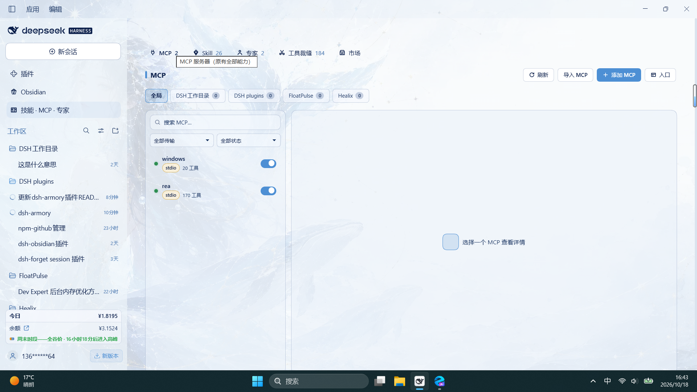
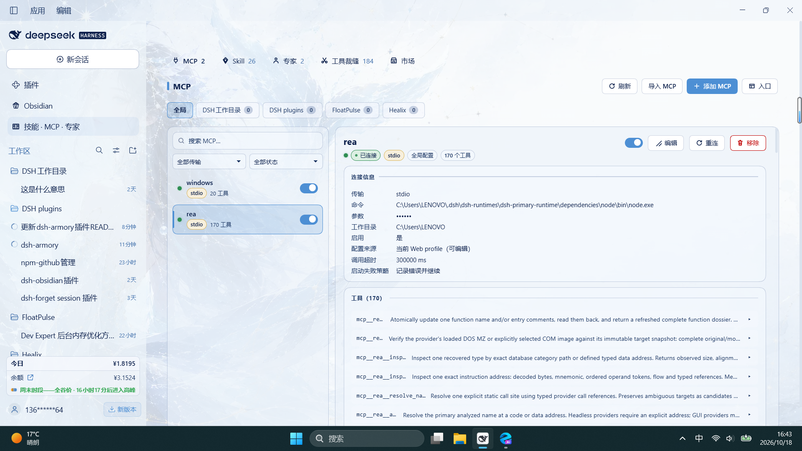
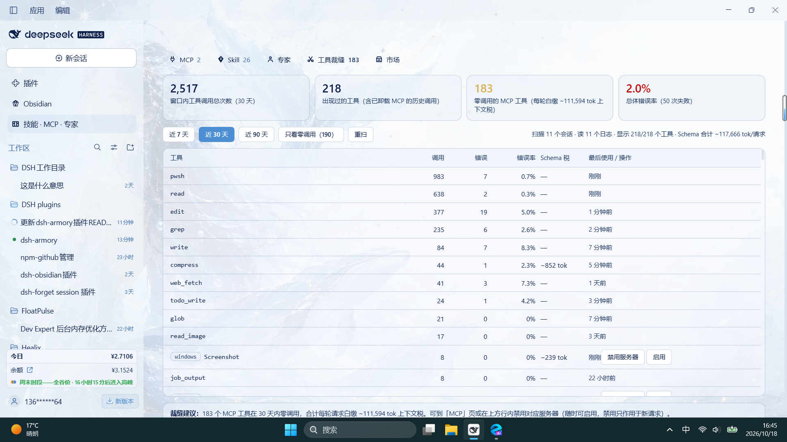
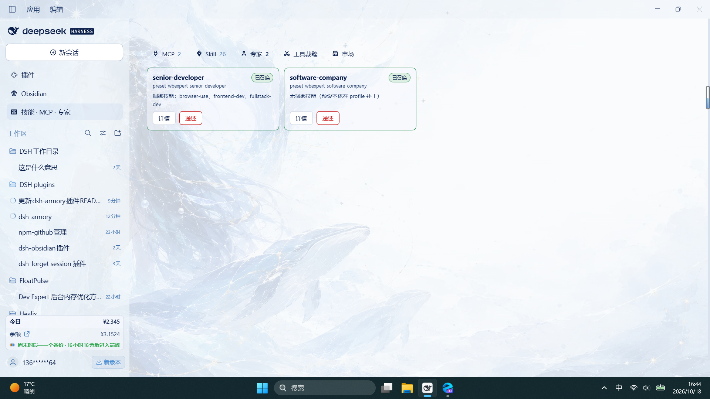
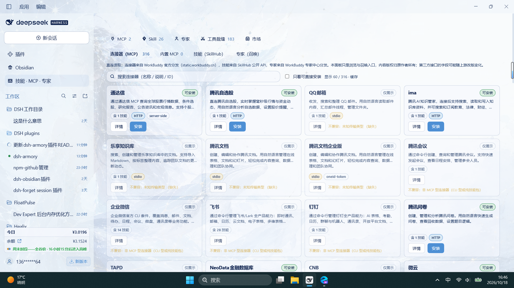
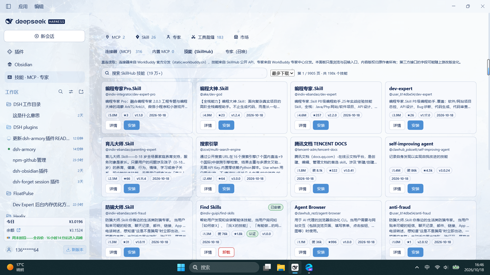
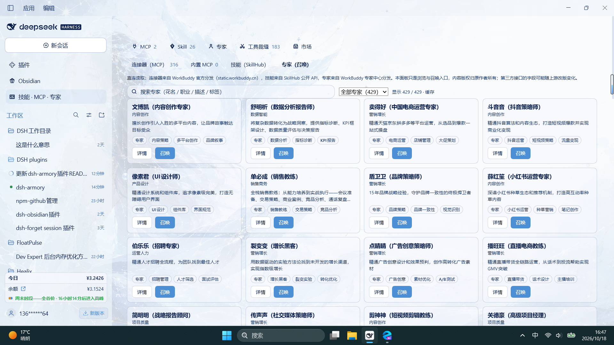

# dsh-armory · Armory

[中文](README.md) | English

> **You should not have to remember what you installed in DSH.**
> Armory puts MCP servers, skills, experts, plugins and four markets on one board: 316 connectors, 190,000+ skills, 429 experts. What is installed, what is connected, and which tools are eating context are all in front of you. You can also call any of it from the session.

<p align="center">
  <a href="https://github.com/2026heshao/dsh-armory/stargazers"></a>
  <a href="https://github.com/2026heshao/dsh-armory/releases"></a>
  <a href="https://www.npmjs.com/package/dsh-armory"></a>
  <a href="./LICENSE"></a>
  
  <a href="https://github.com/topics/dsh-plugin"></a>
</p>



## Install the board

```sh
# npm (recommended: no build approval, ready to use)
dsh plugin --profile web add dsh-armory

# GitHub
dsh plugin --profile web add github:2026heshao/dsh-armory
```

**Quit DSH completely and start it again.** Then open "Big Fish Armory" from the global panel list at the top of the sidebar. The floating button at the bottom right and the sidebar bottom entry open the same board. On desktop, swap `--profile web` for `--profile desktop`.

You can keep one entry, two, or all three. Switch them under "Entries" in the top right of the board. It will not let you close all three and lock yourself out.

> Do not add `dsh-armory` to the profile's `cordis.patch.yml`, an agent preset or an extra `--patch` file by hand. The plugin command already does that, and duplicating it fails loudly on purpose.

## What it keeps an eye on

### MCP: see whether it is connected

Each server gets a row: status, transport, connection settings, tool count. Open it for the full input schema, including required fields, enums and defaults. Credentials are masked. Click the eye to read the effective runtime value for a moment, and click again to hide it. If a server drops, reconnect in place without restarting the host.

Global and project scopes are separate. Global writes to the profile and is available in every project. A project writes to `.dsh/mcp.json` and is visible only to sessions in that project. Inside a project you can hide a global server without touching other projects. Saving a project config applies to live sessions immediately; no restart.

Moving from another client does not mean copying configs by hand. Armory detects 11 clients, including Claude Code, Codex, Cursor, Windsurf, VS Code, Gemini CLI and Roo Code, shows a preview, and imports the ones you pick. A name collision skips that one entry instead of failing the batch. You can also paste an `mcpServers` JSON block.

When a remote MCP needs OAuth, a 401 opens the authorization dialog. The browser completes discovery, registration, PKCE and the callback. The token is written back to the config, and the plugin refreshes it before expiry. If the callback cannot be received, you can paste the callback URL or an access token.



### Tool Tailor: who is eating context

Every MCP tool description travels with the request. A tool nobody calls still takes up space.

Tool Tailor reads local session logs. It looks at call events only, not message content. For the last 7, 30 or 90 days it counts calls, errors and last use per tool, then compares two numbers: the token cost of the schema in the registry, and the token cost of the tool list actually sent in each request. When they differ, your config did not take effect, or the live list is not the registry list.

Tools with zero calls in the window go on a dead-tool list. One click disables the server, and one click brings it back. Skills get the same ledger: a registered skill that was never called is listed, and you can disable it from the row. That writes the official `disable-model-invocation` key to `SKILL.md`; manual `/` invocation still works.



### Experts: summon one into the session

WorkBuddy's expert directory has 429 experts across 15 industries, including 53 teams. Read the persona, see the bundled skills, and hit Summon to attach one to the current session.

You can attach one halfway through a conversation. Replace it by summoning another; remove it with the × on the chip. It only affects that session. The choice is remembered across session switches, restarts and context compaction.

About 185 of the 429 experts have no public persona file. Armory reads your local WorkBuddy cache first, then the public distribution. If neither exists, it writes a stand-in from the public description. The first paragraph says this is not the original and tells you where to put the original file. For team experts, each member's persona is written to disk and the lead is wired to DSH's `subagent` so the original teamwork rules still hold.



### In the session: skills, MCP, experts, this project

The small icon to the right of the composer opens the summon menu. Click a skill to insert `/skill-name`, click an MCP server to name its `mcp__server__*` tools, click an expert to attach it to the current session. The fourth row, This project, lists only the skills and MCP servers that belong to the current project. Recently used entries float to the top.

The skill submenu now has a search box at the top: typing filters by name and description. The Favorites row below it opens the skills you starred, most recent first, six per page; click one to insert its `/name` and close the menu. When there is not enough room on the right, the panel flips left or clamps to the viewport edge.

Skills you use together can be bundled into a suite. One click inserts all of its `/name` tokens in order, so you do not have to hunt through the list every time.

### Markets: four shelves, and installs you can find later

Connectors, skills, experts and plugins live in the same panel. No second website. Cards show the publisher and last update. Details query GitHub on demand and add a plain label: committed in the last 30 days, no update for over 6 months, or archived.

**Connectors**: 316 official WorkBuddy connectors. 242 can be installed; 74 CLI or token-based ones are marked display-only with the reason. Armory checks local dependencies before install. After install, the card reports the real state: connected, needs authorization, or not connected. A 401 or 403 gives you a reauthorize action instead of a reconnect loop. Token-based connectors also tell you where to apply for credentials, with public https links only. No guessed URLs, no filling in values for you.

**Skills**: SkillHub's public API, 190,000+ skills. Search, sort, install in one click. Each file is checked against its sha256 and written to `~/.agents/skills/`, so it is live immediately. The card says "installed 3 hours ago" and stays highlighted for 7 days. The filter bar has a recent-installs timeline. If the board name differs from the market name, the card shows the original name. The top of the board switches between Global and each workspace; a workspace shows only the skills under its `.agents/skills` and `.dsh/skills`. Star a skill to favorite it; the same state is shared by the grid, list and detail views, most recent first, up to 20. Uninstalling a skill keeps its favorite. Unneeded skills can be removed from the detail pane after a second confirmation; removal is permanent.

**Experts**: 429, with category filters and search. Summon from the card.

**Plugins**: two DSH community lists combined, 7,000+ entries, each marked installable or not. Click a card to read its repository README without leaving the panel. Install goes through the host's `pluginManager` and tells you to restart when it is done.

The connector page also has the official MCP Registry as a source, with no WorkBuddy account needed. On Windows, `npx` and `npm` servers added from a market are rewritten to the absolute local `node.exe`, so they no longer fail with "connection closed" and burn through reconnects.





### A record of what you installed

`~/.dsh/armory/install-state.json` records the market each connector, skill and plugin came from, and separates "installed by Armory" from "configured by hand". The market can filter installed entries across pages.

Loadout exports your MCP servers, skills, experts and plugins as a JSON file. Paste or import it on another machine and Armory compares each item as installed, update available, or missing. The file contains names, types, sources, versions and the identifiers needed to match them. It does not contain keys, headers, environment values, skill bodies or personas.

## Who it is not for

If you only use DSH for occasional chat and have no MCP servers, skills or experts, you do not need this board. It solves the problem that shows up after you install a few things: you cannot remember what is there, find what you just added, or turn off what is costing you.

## What it will not do

- It will not upgrade itself. A new release shows a banner; nothing happens until you click Upgrade. Tag-pinned installs do not jump versions.
- It will not send secrets to the browser. The market tells you which variable names are needed; values stay in the host config.
- It will not touch your other config. Global edits only change MCP entries owned by this plugin. Other bundles, comments and `!!js` expressions are left alone.
- Uninstalling the plugin does not delete your MCP entries or your project `.dsh/mcp.json`.
- Third-party market entries keep their source labels. Links must be https (http only for loopback).

## Upgrade and compatibility

Upgrade from the banner in the panel, or run `dsh plugin --profile web update dsh-armory`. **Quit DSH completely and start it again**; the host-side modules load once at process start. Uninstall with `dsh plugin --profile web remove dsh-armory`; existing MCP entries stay.

DSH `0.1.5-rc.1` or newer. Tested through `0.2.1-rc.2` (DSH 44.7.0) on Windows; Linux and macOS use the same DSH web contract.

The UI follows DSH's language. Chinese shows Chinese; other locales fall back to English. To force English, set `localStorage['dsh-armory.locale'] = 'en-US'` in DevTools and reload.

## FAQ

**Nothing changed after an upgrade.**
Check the installed version first: the title of the "What's new in vX.Y.Z" card on first open, or `version` in `~/.dsh/profiles/<profile>/node_modules/dsh-armory/package.json`. Then quit DSH completely and start it again. Reloading the panel is not enough.

**The panel says a server is disabled, but the model reports `unknown tool`.**
That server is disabled, so it registers no tools. Enable it in the panel.

**An MCP added on Windows will not connect.**
Since 2.4.5, bare `npx` and `npm` are rewritten to absolute local paths. A config imported from another machine may point at paths that do not exist here; add it through the market again.

**The expert detail says the persona is not the original.**
The upstream directory has no public persona for that expert. The stand-in still works for summoning. Put the original at `~/.dsh/wb-market/experts/overrides/<package>.md` and reopen the detail.

**Will uninstalling delete my config?**
No. Existing MCP entries and project `.dsh/mcp.json` files stay.

## Docs and development

- [Full feature list](docs/features.md) (Chinese)
- [Installation and upgrades](docs/installation.md) (Chinese)
- [JSON import](docs/json-import.md) (Chinese)
- [Design and limits](docs/design.md) (Chinese)
- [Market load performance](docs/perf-market-load.md) (Chinese)
- [Project MCP lifecycle](docs/project-mcp-lifecycle.md) (Chinese)
- [Releases](https://github.com/2026heshao/dsh-armory/releases)

```sh
npm install --no-save yaml@2 eslint@9
npm test       # 73 suites
npm run lint
```

CI and the release gate run the same two commands. Details in [installation](docs/installation.md#发布流程维护者) (Chinese).

## Links

- [DeepSeek Harness](https://github.com/deepseek-ai/deepseek-harness)
- [LINUX DO](https://linux.do/)
- [GitHub `dsh-plugin` topic](https://github.com/topics/dsh-plugin)

## Credits

Forked from [Imzl-zl/dsh-mcp-manager-ui](https://github.com/Imzl-zl/dsh-mcp-manager-ui) (MIT). Market data comes from WorkBuddy, SkillHub, the official MCP Registry and the DSH community lists; rights stay with their publishers.

License: MIT
