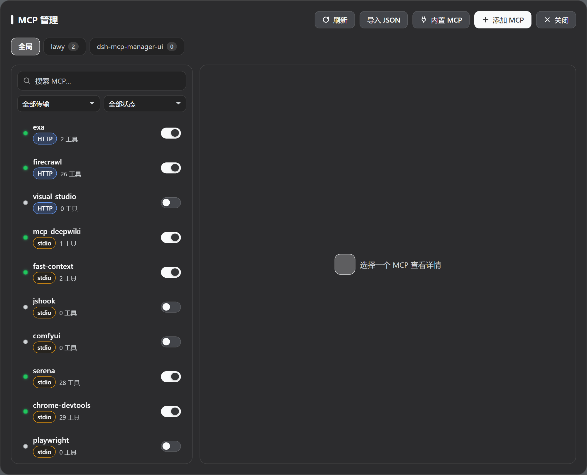
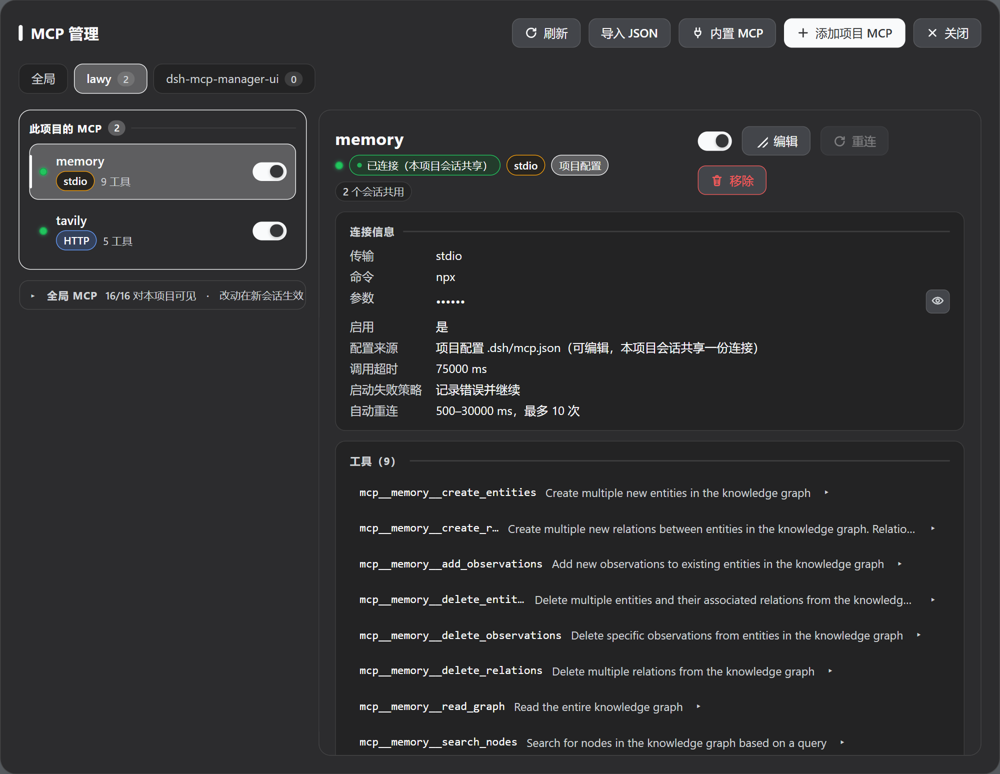
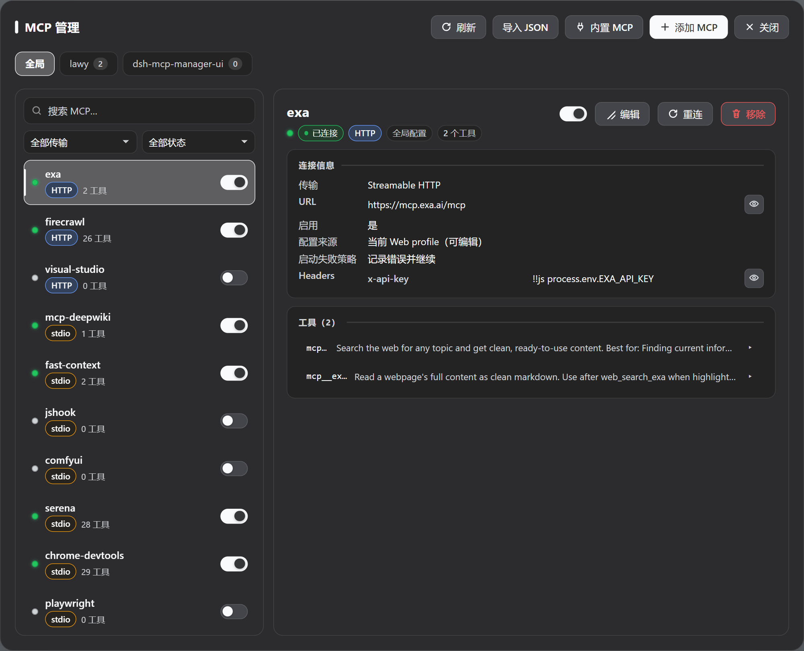
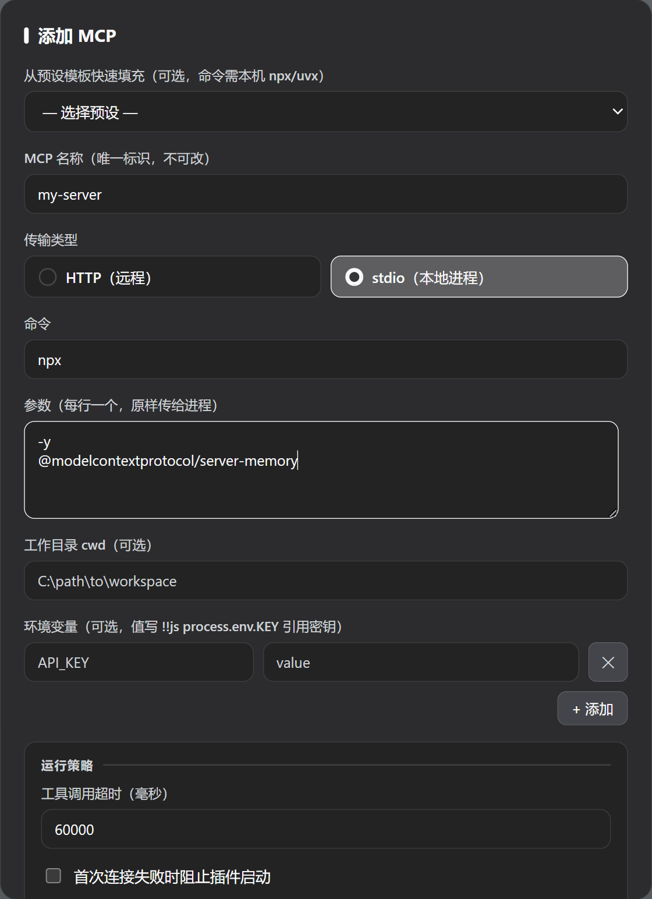

# dsh-armory — 军械库 / Armory

中文 | [English](README.en.md)

> **DeepSeek Harness 的一体化管理看板**：MCP 服务器 · 技能 · 专家 · 工具使用账本 · 三大市场（WorkBuddy 连接器 316 个 / 内置精选 47 个 / SkillHub 技能 19 万+ / WorkBuddy 专家 429 位），浏览、搜索、一键安装、一键召唤。
> 本项目 fork 并改写自 [Imzl-zl/dsh-mcp-manager-ui](https://github.com/Imzl-zl/dsh-mcp-manager-ui)（MIT，原项目仅 MCP 管理），现仓库为 [2026heshao/dsh-armory](https://github.com/2026heshao/dsh-armory)，
> 从纯 MCP 管理面板升级为 **MCP + 技能 + 专家 + 市场 + 工具账本** 五合一看板。

<p align="center">
  <a href="https://github.com/2026heshao/dsh-armory/stargazers"></a>
  <a href="https://github.com/2026heshao/dsh-armory/releases"></a>
  <a href="https://www.npmjs.com/package/dsh-armory"></a>
  <a href="./LICENSE"></a>
  
  <a href="https://github.com/topics/dsh-plugin"></a>
</p>

## 一键安装

```sh
# npm（推荐：免构建授权，装完即用）
dsh plugin --profile web add dsh-armory

# GitHub
dsh plugin --profile web add github:2026heshao/dsh-armory
```

装完**重启 DSH**，侧栏顶部「全局面板」里点 **技能 · MCP · 专家**（或右下角悬浮按钮）。桌面端装在 `desktop` profile 时把 `--profile web` 换成 `--profile desktop`。

## 它解决什么

| 痛点 | 本插件的做法 |
|---|---|
| MCP 配置要手改 YAML，改完不知道连没连上 | 可视化面板：状态、工具 Schema、启停、重连，全局与项目双作用域，项目级改完即对存活会话生效 |
| 装技能要去各处翻 `SKILL.md` 仓库 | **市场直连**：SkillHub 19 万+ 技能、WorkBuddy 316 个连接器、47 个一手核实的内置服务，搜索/筛选/一键安装，逐文件 sha256 校验 |
| 每个 MCP 的工具描述都在吃上下文 token，零调用的工具白白占位 | **工具裁缝**：扫描本机会话日志统计每个工具的调用/错误/延迟，死工具清单一键禁用 |
| 从 Claude/Cursor/VS Code 迁移要逐条抄配置 | 自动检出 11 种客户端的本机配置，预览后一键导入 |

## 界面预览

### 全局管理面板



### 项目作用域（`.dsh/mcp.json`）



### 连接详情与新增





## 功能

- 查看每个 MCP 的状态、传输方式、连接参数与工具列表；展开工具可看完整输入 JSON Schema（必填/可选、类型、枚举、默认值与原始 JSON）
- 按传输方式（HTTP/stdio）与状态筛选，按名称/命令/URL 搜索
- 启用、禁用、重连、添加、编辑、移除；需要时用眼睛临时揭示被掩码的凭据并一键复制
- **全局 + 项目双作用域**：全局写 Web profile，一次注册所有项目可用；项目写该项目 `.dsh/mcp.json`，只该项目会话可见；项目里还能「屏蔽」某个全局 MCP
- **两个入口，同一个面板**：右下角悬浮按钮（可拖拽、记忆位置）与官方侧栏入口（展开态在「设置」上方显示「MCP」，收起成 56px 轨道时只剩图标）共享同一开关状态；面板右上角「入口」可以把两者只留一个（不能都关）
- **MCP 市场**：47 个逐条一手核实过的服务，分 10 类（搜索、开发工具、安全与逆向、数据库与数据、AI 与知识、浏览器自动化、云与基础设施、效率协作、文件与本地、通讯）。搜索为主操作，配分类与「只要免密钥」筛选、排序、卡片直接安装；每条如实标注免费额度与需要准备什么（密钥 / 连接信息 / 装完还得改的参数）。已配置的只识别并跳过，不覆盖
- 导入本机其他客户端的 MCP 配置：自动检测 Claude Code、Codex（`config.toml`）、OpenCode（含 `.jsonc`）、pi、Claude Desktop、Cursor、Windsurf、VS Code、Gemini CLI、Roo Code 与跨工具的共享配置，逐个列出，点一条即导入；也能粘贴 Claude/Cursor/Cline/Roo 的 `mcpServers` 或 VS Code 的 `servers` JSON。写入前预览，支持「合并（同名更新）」与「替换」
- 跟随 DSH 深色/浅色主题，适配窄屏与移动宽度
- 更新提示与**一键升级**：有新版时在面板顶部显示可关闭的提示条（每天最多查一次，可用 `DSH_ARMORY_DISABLE_UPDATE_CHECK` 关闭）。点了「升级」才动，**不会自动升级**；升级由 DSH 官方的 pluginManager 执行，装完提示重启宿主生效。用 `link:` / `file:` / `github:` 装的本地开发副本不给按钮（那会把链接换成 npm 包）
- **升级后主动说一次变了什么**：版本变了后第一次打开面板弹一张小卡片，列出本次更新内容，并指路新功能在哪（例如「入口」开关在面板右上角）；确认一次后不再提示，不联网、不发任何数据
- **工具裁缝**（1.7.0 新增）：扫描本机会话日志（只解析 `tool/call` / `tool/result` 两类事件，不读消息正文），统计每个工具近 7/30/90 天的调用次数、错误率与最后使用时间；同时按当前注册表估算每个工具 Schema 每轮请求占用的上下文 token。窗口内零调用的 MCP 工具自动进「死工具清单」，行内可一键禁用/启用对应服务器（复用官方写链，随时可恢复）。**默认显示全部工具与真实调用次数**，零调用的行以底色标出；想只看死工具时点「只看零调用（N）」切换。顶部说明栏常驻回显「显示 N/M 个工具」，避免筛选态被误读成「所有计数都是 0」。全程只读，多帧 zstd 日志逐帧解析、个别帧损坏跳过不中断
- **WB 市场（直连安装，1.8.0 新增）**：看板第四个分类，两个市场一处浏览——
  - **连接器（MCP）**：直读 WorkBuddy 官方分发 ZIP（`static.workbuddy.cn`，与 WorkBuddy 桌面端同一数据源），316 个连接器按需解析；可安装的 242 个（streamable-http 为主），CLI 型 / 需 WorkBuddy token 注入的 74 个如实标注「仅展示」并给出原因。安装 = 把该连接器的 `mcpServers` 合并写入 MCP 配置，与「导入 JSON」同一链路（准入、同名跳过、entry id 预留一致），全局与项目作用域都可选；ZIP 按 ETag 缓存在 `~/.dsh/wb-market/`，解压用 Node 内置 zlib，**零新增运行时依赖**
  - **技能（SkillHub）**：直读 SkillHub 公开 API（`api.skillhub.cn`，19 万+ 技能），支持搜索（`keyword`）、排序（下载/安装/星标/评分）、分页；详情含发布方认证与安全扫描状态。安装 = 逐文件下载并按清单 sha256 校验后写入 `~/.agents/skills/`（与官方 skill 子系统同一发现范围），装完即刻生效；已装的显示「已安装」，可一键卸载、重装即更新
  - 技能版权归原作者所有；两个均为第三方接口，字段可能随上游改版变化（面板顶部有常驻说明）
- **专家直连（1.9.0 新增，体验对齐 WorkBuddy 专家中心）**：看板独立分类「专家」（侧栏入口同步更名「技能 · MCP · 专家」）——
  - **目录**：直读 WorkBuddy 专家中心官方分发（`expert_center.json`，429 位专家 / 15 个行业分类，ETag 缓存在 `~/.dsh/wb-market/experts/`），分类筛选 + 关键词搜索 + 详情弹层（召唤前看人设正文、捆绑技能、试试这样问）
  - **召唤** = 往 profile 补丁写入一条**独立 Agent 预设**（`@deepseek-ai/dsh-agent-preset` 行，plugins 复刻内置 standard 预设、仅 persona 的 prefix 换成专家人设全文）——新建会话时选择「WorkBuddy 专家 · …」即专家接管该会话，标准工具/规划/压缩/委派原样保留；多个专家可共存，写入走既有 patch 写链（文件锁 + 版本校验 + 原子写），其余条目、注释与 `!!js` 表达式原样保留
  - **捆绑技能**：召唤时可勾选一并安装——本机 WorkBuddy 缓存（`~/.workbuddy/plugins/cache/experts/`）有完整技能树就整目录复制到 `~/.agents/skills/`（`wbexpert__` 前缀，即刻被技能注册表发现）；无缓存时按 CDN 的 SKILL.md 单文件兜底并如实标注来源
  - **团队型专家（1.9.4 可召唤）**：WorkBuddy 的 53 个「专家团」人设原本依赖 `TeamCreate` / `Agent(name=…)` 两个 DSH 没有的工具。召唤时除了写主理人预设，还会把每位成员的人设各自落成一份文件（`~/.dsh/wb-market/experts/teams/<专家>/`），并在主理人人设末尾追加一段**运行时适配**：建团队 → 无需调用（编制已在召唤时固定）；派活 → `subagent`（先把该成员人设 `read` 出来拼进 prompt），顺序 SOP 传 `run_in_background: false` 当场等结果；续聊用 `send_message`。原人设的铁律（不得代写成员产出、成员之间不直连、一切经主理人中转）原样保留。成员人设**不进系统提示**（否则每轮都要为 5 份人设白付上下文费），只在调度时按需读取
  - **送还** = 摘除该召唤预设、对应技能目录与团队成员人设（热加载，无需重启）
- **召唤菜单（会话内快速调用，1.9.3 增强）**：会话输入框工具行右侧的看板小图标 → 「技能 / MCP / 专家」三分类，悬停展开子菜单，点一条即把引用写进输入框（技能 = `/技能名`、MCP = 点名 `mcp__服务__*`、专家 = 挂到当前会话）——
  - **每屏 6 行 + 滚动**：子菜单一次显示 6 条，超出的往下滚（细滚动条跟随主题）；「管理技能 / MCP / 专家…」固定在底部，不被列表滚走
  - **最近使用置顶**：刚用过的条目自动排到最前并带「最近」标记，其余保持原有顺序；最近使用记录池 40 条
  - **专家随时挂 / 换 / 摘**：点一个专家即接管当前会话（包括已经聊了一半的），再点别的直接替换，点 chip 的 × 立刻取消；**只影响这一个会话**，不动工具目录、不写任何持久化配置
  - **显示与实效一致**：挂专家后，会话标题栏显示的始终是**当前真正生效**的专家（宿主那条「会话创建时的预设」标签在挂载期间自动让位）；三处显示（标题栏徽章、输入框 chip、菜单）挂/换/摘后同帧同步

## 安装

```sh
# 从 npm 安装（推荐）
dsh plugin --profile web add dsh-armory

# 从 GitHub 安装
dsh plugin --profile web add github:2026heshao/dsh-armory
```

装完**重启 DSH**（桌面端重启应用，Web 端重启 `dsh web`；桌面端把 `--profile web` 换成 `--profile desktop`）。升级：npm 安装可在面板「一键升级」提示条上直接点，GitHub 安装换新版 tag 重新 `add`。卸载（不会删除 profile 里已有的 MCP 条目）：

```sh
dsh plugin --profile web remove dsh-armory
```

细节、本地开发安装与故障排查见 [安装与升级](docs/installation.md)。

> 不要把 `dsh-armory` 手工插进 profile 的 `cordis.patch.yml`、Agent preset 或额外的 `--patch` 文件——插件命令已经完成这件事，重复装配会明确报错。

## 使用

### 打开面板

两个入口，同一个面板：

- **右下角悬浮按钮**：可拖拽移动，位置会被记住；
- **侧栏「技能 · MCP · 专家」**：展开态在「设置」上方，侧栏收起成 56px 轨道时只剩图标。

面板浮在会话之上，关掉它（右上角「关闭」或 Esc）不会影响会话。

两个入口都能单独关掉：面板右上角「入口」里选 `悬浮按钮 + 侧栏入口`（默认）/ `仅悬浮按钮` / `仅侧栏入口`。**不能两个都关**——面板只能从这两个入口打开，所以这是一个三选一，而不是两个独立的开关。选择存在浏览器本地（localStorage），换浏览器或清缓存要重选一次。

### 全局 vs 项目

顶部标签页在「全局」与各项目之间切换：

| 标签页 | 存哪 | 谁可见 | 改动何时生效 |
|---|---|---|---|
| 全局 | Web profile 的 `cordis.patch.yml` | 所有项目 | DSH 热加载，通常立即生效 |
| 某项目 | 该项目 `.dsh/mcp.json` | 只该项目会话 | 写盘即生效（见下） |

`serverName` 按作用域判重：不同项目之间、全局与项目之间**可以同名**，各自独立连接；同一作用域内不能重名。

### 常用操作

在列表行或详情页里：

- **开关**：启用 / 禁用（全局写 profile 补丁的 `disabled`，项目写 `.dsh/mcp.json`）；
- **重连**：全局条目重载 loader 条目；项目连接会拆掉旧连接、按当前配置重建并重新投射给存活会话（`mcp-client` 的重连预算耗尽后必须靠它恢复）；
- **编辑 / 移除**：移除只影响当前作用域；
- **屏蔽**（项目页里对全局 MCP）：写 `exclude`，该项目的新会话不再看到它——全局实例仍在跑，所以不影响其他项目。

### 添加 MCP

三条路，都从面板顶部工具栏进：

1. **添加 MCP**：表单填 `command`/`args`/`env`/`cwd`（stdio）或 `url`/`headers`（HTTP），可设调用超时、启动失败策略与重连策略；常用服务器有预设模板可一键套用。
2. **导入 JSON**：粘贴其他客户端的配置，先预览再写入。支持「合并（同名更新）」与「替换」，字段映射与限制见 [JSON 导入](docs/json-import.md)。
3. **内置 MCP**：勾选未配置的项一次装好（Exa、Tavily、Firecrawl、Chrome DevTools、Playwright）。前三项有免密额度、不需要本地依赖；后两项是本地工具，需要 Node.js 与浏览器。已配置的项只识别并跳过，不会覆盖。

### 看工具与敏感值

详情页列出该 MCP 当前注册的工具；展开可看完整输入 Schema。凭据类字段默认掩码，点眼睛图标会向 Host 读取**有效运行值**（已解析过的环境变量）并临时显示，再点一次恢复；已显示的值可一键复制。编辑时若没实际改动输入，保存仍保留原来的引用写法，不会把密钥写回配置文件。

## 配置生效时机（重要）

| 作用域 | 修改后何时生效 |
|---|---|
| 全局 | DSH 热加载，通常立即生效（含运行中的会话） |
| 项目 | **写盘即生效**：新增立刻挂上存活会话、删除立刻撤掉工具、改动就地重载连接（工具名不变） |

项目 MCP 由本项目所有会话共用一份连接，配置写在 `.dsh/mcp.json`。面板保存的那一刻就会对齐到正在运行的会话，**不需要重开会话，也不需要重启 Host**；手工编辑该文件则在**下一次会话挂载**时被采纳。

> **连接跟配置走，不跟会话走**：最后一个会话结束不会拆掉连接，它只进入空闲等待，下一次会话直接复用——这样"要用的时候"它已经就绪（这也是宿主自己的契约：工具必须在首轮之前出现）。两个旋钮写在 server 条目里：`idleTimeoutMs`（空闲保留多久，默认 5 分钟，`0` = 永不回收）与 `readyTimeoutMs`（挂载时等就绪的总预算，默认 5s，`0` = 不等）。字段速查与边界见 [设计与限制](docs/design.md#项目级专有字段dshmcpjson-里每个-server-可写)。
>
> **状态怎么看**：项目行把两件独立的事分开说，不合成一个状态。
> - **连接在不在**：`已连接 · 当前无会话使用（连接保留，下次直接用）` / `已连接 · N 个会话在用` / `连接中…` / `连接失败` / `尚未建立连接（新会话自动挂载）`。
> - **几个会话在用**：见上一行的 `N 个会话在用`；不再出现「待会话挂载」那种把两者压成一句、容易被读成"还没连上"的写法。
>
> **重连是必需出口**：mcp-client 的自动重连有次数上限，耗尽后它会注销工具并停止，只能靠重载配置或重启宿主恢复（它的 README 明写）。项目 MCP 又不是常驻服务，所以面板的「重连」按钮会拆掉旧连接、按当前配置重建，并重新投射给存活会话。

## 常见问题

**面板里显示「已禁用」，但模型调用报 `unknown tool "mcp__xxx__..."`**
那个 MCP 被禁用了，所以它没有注册任何工具。在面板里点「启用」即可（全局会写 profile 补丁并热加载，项目写 `.dsh/mcp.json`、写盘即生效）。

**那一行显示「挂载失败」「连接失败」或「作用域隔离失败」，怎么区分？**
三类是不同的事，详情页会给出具体原因：**挂载失败** = **会话挂载阶段**（`agent/created` 监听器）就没挂上（变量求值为空、`failOnStartupError` 下启动失败、工具注册被拒）；**连接失败** = `mcp-client` 连不上或重连耗尽（原因取自它的日志）；**作用域隔离失败** = 连接正常但工具不在共享作用域层（宿主里出现了两份 `@deepseek-ai/dsh-scope`）。排查与原理见 [设计与限制](docs/design.md#连接状态语义)。

**项目行那些状态文案分别是什么意思？**
它们把两件独立的事分开说：**连接在不在** —— `已连接 · 当前无会话使用（连接保留，下次直接用）`（最后一个会话结束了，连接按空闲策略留着）/ `已连接 · N 个会话在用 · M 工具` / `连接中…` / `连接失败` / `尚未建立连接（新会话自动挂载）`；**几个会话在用** —— 就是那句里的 `N 个会话在用`。旧版本的「待会话挂载」正是把这两件事压成一句，所以容易被读成"还没连上"。

**怎么升级？为什么面板没提示？**
从 npm 装的直接 `dsh plugin --profile web update dsh-armory` 就会升小版本，也可以直接点面板提示条上的「升级」（同一件事，免去敲命令）。面板的提示条只查 GitHub Releases、每天最多一次、可关闭、不会自己动；固定 tag 安装的用户不会自动跨版本，需要用新 tag 重新 `add`（见 [安装与升级](docs/installation.md)）。

**改动会不会碰到我的其他配置？**
不会。全局改动只动 profile 补丁里由 `@deepseek-ai/dsh-mcp-client` 声明、且由本插件管理的条目，保留其他插件条目、注释与 `!!js` 表达式；导入「替换」也只替换这一部分，不会删除其他 bundle 或 Agent preset 自带的 MCP。

**卸载后我配置的 MCP 会消失吗？**
卸载插件不会删除 profile 里已有的 `@deepseek-ai/dsh-mcp-client` 条目；项目的 `.dsh/mcp.json` 也留在原处（它本来就是普通 JSON 文件）。

## 兼容性

| 项目 | 已验证 |
|---|---|
| DeepSeek Harness | `0.1.5-rc.1` 及以上（已验证至 `0.2.1-rc.2`，DSH 44.7.0） |
| Node.js | DSH 自带/支持的运行时 |
| 平台 | Windows；Linux/macOS 使用同一 DSH Web 契约 |

只支持 0.1.5 起（更早的版本缺少「按注册作用域判 `serverName` 唯一性」与「setup 传入 agent」两个能力），不为旧版本保留降级分支。原因与依赖细节见 [设计与限制](docs/design.md#兼容性与依赖细节)。

## 开发

```sh
npm install --no-save yaml@2            # 测试唯一的裸依赖（node:test 内置）
npm test                                # 全 6 套件（与 CI / 发版门槛同一条）
npm run test:e2e                        # 可选：用宿主补丁算法验证专家预设进入组合树
dsh --profile web --dump-config         # 看 profile 的有效配置
dsh web                                 # 起 Web 做真实操作验证
```

`npm test` 跑的是 `test/run-all.mjs`，依次执行 6 个独立套件（各自是独立 node 进程，任一非零退出即整体失败）：

| 套件 | 覆盖 |
| --- | --- |
| `run-expert-manual.mjs` | 专家市场写链：真网拉 WorkBuddy 专家目录（ETag 命中后走磁盘缓存）与 senior-developer 人设，对 `lib/expert-market.js` 的 patch 写链做 33 条断言——含 1.9.1 修复的回归用例（召唤预设必须写成顶层 `- insert:` 指令、旧版顶层裸条目要能被迁移） |
| `upgrade-plan.mjs` | 一键升级安全判据：本地安装 / 来源未知一律不写盘 |
| `session-persona.mjs` | 会话级专家随时挂 / 换 / 摘（替身宿主验证 systemPrompt 作用域与 ctx 重绑两个假设） |
| `team-bridge.mjs` | 团队专家桥接：成员人设落盘、桥接段内容、preset 不含成员正文、送还清理、取不到人设时降级 |
| `verify-install-info.mjs` | 真 profile 数据下的安装来源判定（profile 不存在时自动 SKIP） |
| `verify-host-installinfo.mjs` | 宿主读取路径下的安装来源判定 |

本机存在 `~/.dsh/profiles/desktop/cordis.patch.yml` 时，`run-expert-manual.mjs` 会追加一组真实 profile 往返断言，没有则记 `SKIP`。

CI（push 到 main / PR，见 `.github/workflows/ci.yml`）与发版门槛（推 tag，见 `.github/workflows/release.yml`）跑的是**逐字相同**的命令（装 `yaml@2` → `node ./test/run-expert-manual.mjs`），两处口径不许分叉；发版流程见 [安装与升级](docs/installation.md#发布流程维护者)。

> 本机若没有 `yaml`，`npm test` 会以 `ERR_MODULE_NOT_FOUND` 退出——`test/loader.mjs` 会先试标准解析，失败才回退开发机的 profile 副本（`~/.dsh/profiles/desktop/node_modules`），所以干净环境必须先装依赖。

## 文档

- [安装与升级](docs/installation.md)
- [JSON 导入](docs/json-import.md)
- [设计与限制](docs/design.md)（共享连接模型、连接状态语义、已知限制、依赖细节）
- [DeepSeek Harness 官方插件发布指南](https://github.com/deepseek-ai/deepseek-harness/blob/master/docs/user/develop/basic/publish.md)

## 相关链接

- [LINUX DO](https://linux.do/)（友链）
- [DeepSeek Harness](https://github.com/deepseek-ai/deepseek-harness)
- [GitHub `dsh-plugin` 主题](https://github.com/topics/dsh-plugin)

## License

MIT
