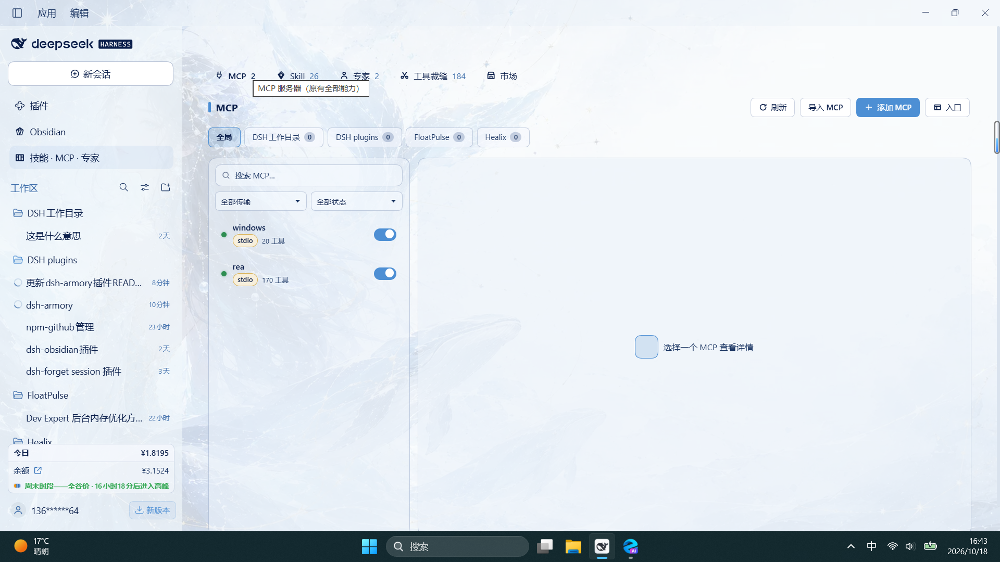
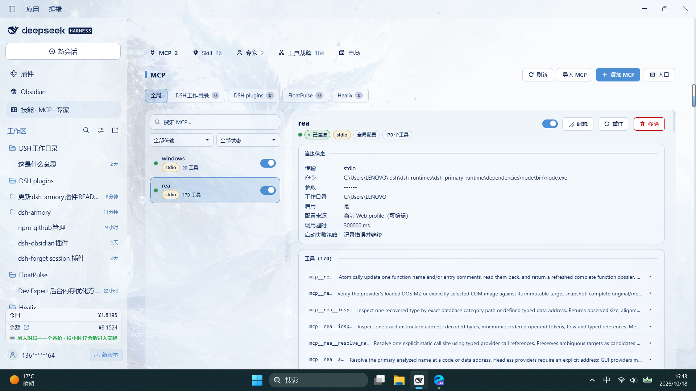
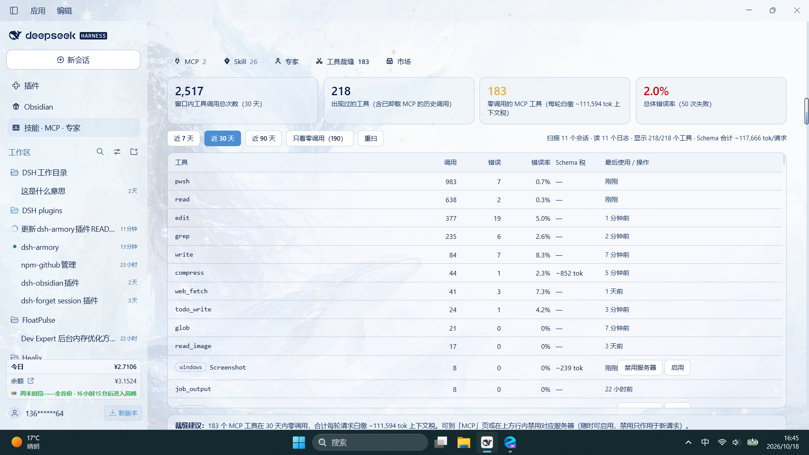
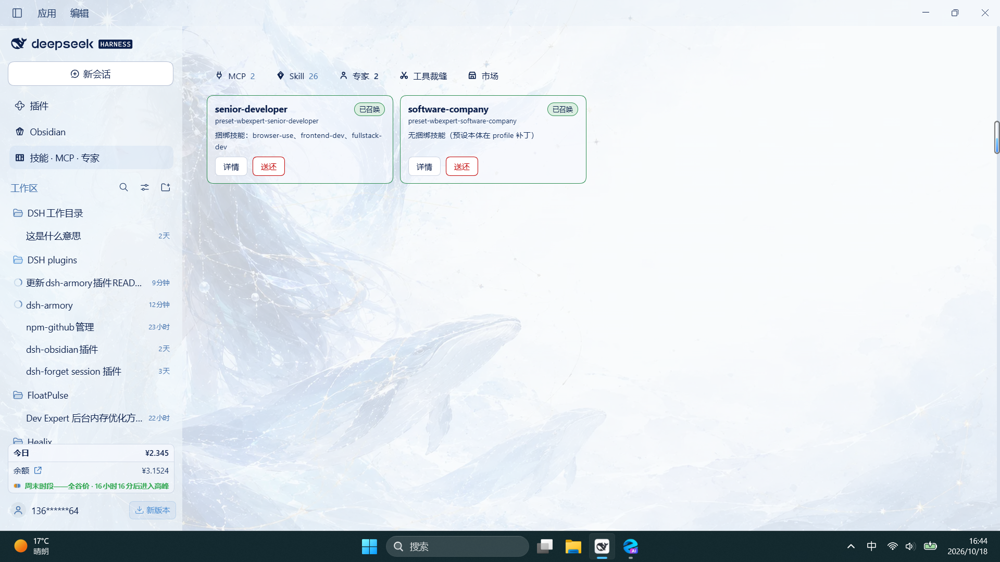
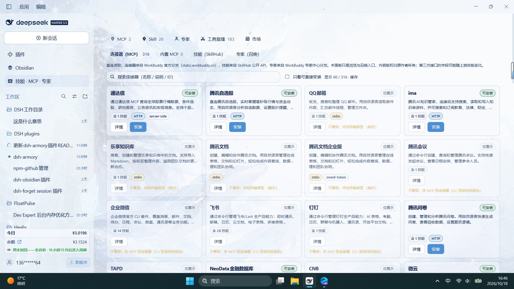
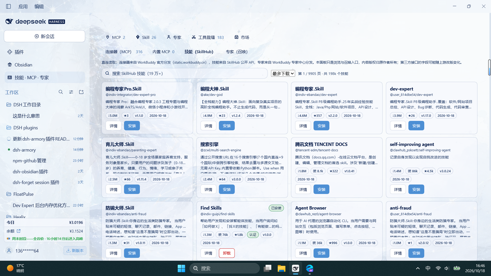
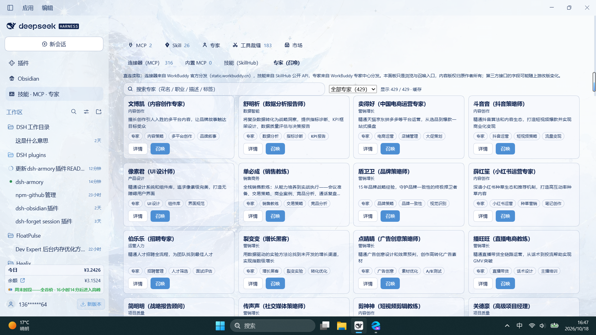

# dsh-armory · 军械库

中文 | [English](README.en.md)

> **你不需要记住 DSH 里装过什么。**
> 军械库把 MCP、技能、专家、插件和四个市场收进一块面板：316 个连接器、19 万+ 技能、429 位专家。装过什么、连没连上、哪些工具在吃 token，打开就能看见；会话里要用什么，也能直接叫出来。

<p align="center">
  <a href="https://github.com/2026heshao/dsh-armory/stargazers"></a>
  <a href="https://github.com/2026heshao/dsh-armory/releases"></a>
  <a href="https://www.npmjs.com/package/dsh-armory"></a>
  <a href="./LICENSE"></a>
  
  <a href="https://github.com/topics/dsh-plugin"></a>
</p>



## 装上一块面板

```sh
# npm（推荐，免构建授权）
dsh plugin --profile web add dsh-armory

# 从 GitHub
dsh plugin --profile web add github:2026heshao/dsh-armory
```

装完**完全退出 DSH 再启动**。左上角「全局面板」里会多一行「大肥鱼军械库」，点开就是；右下角悬浮按钮和左侧栏底部也能进。桌面端把 `--profile web` 换成 `--profile desktop`。

三个入口可以只留一个，也可以全开。面板右上角「入口」里切，不会出现三个都关掉、自己开不了的局面。

> 不要把 `dsh-armory` 手工插进 profile 的 `cordis.patch.yml`、Agent preset 或额外的 `--patch` 文件。插件命令已经完成这件事，重复装配会明确报错。

## 它替你看住的东西

### MCP：连没连上，一眼看到

每个 MCP 一行：状态、传输方式、连接参数、工具数。展开能看到完整的输入 Schema，必填、可选、枚举、默认值都在。凭据默认打码，需要时点一下临时显示，再点一次收回。连不上时就地重连，不用重启宿主。

全局和项目分开管。全局写 profile，所有项目可用；项目写 `.dsh/mcp.json`，只对这个项目的会话可见。项目里还能屏蔽某个全局 MCP，别的项目不受影响。项目配置保存即对正在运行的会话生效，不用重开会话。

从别的客户端搬过来，也不用逐条抄。Claude Code、Codex、Cursor、Windsurf、VS Code、Gemini CLI、Roo Code 等 11 种客户端的配置会被自动检出，预览后一键导入；同名冲突只跳过那一条。粘贴 `mcpServers` JSON 也行。

远端 MCP 要 OAuth 时，服务器返回 401 会直接弹出授权框；浏览器走完发现、注册、PKCE 和回调，令牌写回配置，由插件在到期前刷新。回调收不到时，可以粘贴回调地址或访问令牌。



### 工具裁缝：谁在吃 token

每个 MCP 的工具描述都会跟着请求进上下文。零调用的工具不干活，但照样占位。

工具裁缝读本机会话日志，只看调用事件，不读聊天正文。它按 7 / 30 / 90 天统计每个工具的调用、错误率和最后使用时间，再算两笔账：注册表里这份 Schema 值多少 token，线上下发的清单又值多少。两个数对不上，就说明你改了配置没生效，或者线上和注册表不是同一份。

窗口内一次没调用的工具会进死工具清单，行内一键禁用，随时恢复。技能也有账本：注册了但一次没被调用，照样列出来；不想让它占上下文，可以在行内禁用，手动 `/引用` 不受影响。



### 专家：叫一个进当前会话

WorkBuddy 专家中心有 429 位专家、15 个行业，其中 53 个是团队。看详情、看人设、看捆绑技能，点「召唤」就挂到当前会话。

聊到一半也能挂；换一个直接替换，点 chip 的 × 取消，只影响这一个会话。选择会随会话记住：切会话、重启 DSH、上下文压缩后 agent 重建，都会自动补回来。

上游有 185 位专家没有公开的人设文件。军械库会先读本机 WorkBuddy 缓存，再读公开分发；都没有，就用公开介绍生成一份兜底人设，正文第一段写明「这份人设不是原文」，并告诉你把原文放到哪个路径。团队专家会把每位成员的人设落到本机，再用 DSH 的 `subagent` 接上原来的协作流程。



### 会话里：技能、MCP、专家、本项目

输入框右侧的小图标打开召唤菜单。点技能插入 `/技能名`，点 MCP 点名 `mcp__服务__*`，点专家挂到当前会话；第四项「本项目」只列当前项目自己的技能和 MCP。最近用过的排在最前。

技能二级菜单顶部有搜索框，输入即按名称和描述筛选。下面的「收藏」行展开是最近收藏的技能，最多一屏 6 条，点一条直接插入 `/name`；右侧空间不够时会自动向左或贴边展开。

常一起用的技能可以打包成「套件」，点一次就按顺序插入多个 `/name`。不用每次都翻列表。

### 市场：四个货架，装完找得回来

连接器、技能、专家、插件，四个市场都在面板里，不用另开网页。卡片上能看到发布方和最近更新，详情再按需查 GitHub，直接标出「近 30 天有提交 / 超过半年未更新 / 已归档」。

**连接器**：316 个 WorkBuddy 官方连接器。242 个可装，CLI 型或需要 token 注入的 74 个标明「仅展示」并写原因。装之前先检查本机依赖；装完按真实连接态显示「已连接 / 需授权 / 未连接」，401 或 403 就地给「重新授权」。token 型连接器还会告诉你凭据去哪申请，只给公开 https 链接，不猜地址、不代填。

**技能**：SkillHub 公开 API，19 万+ 技能。搜索、排序、一键安装，逐文件 sha256 校验，装进 `~/.agents/skills/` 立刻生效。装完卡片上标「装于 3 小时前」，7 天内高亮；筛选条有「最近安装」时间线；看板名和市场名不一致时，会标「来自市场 原名」。不用再翻目录猜哪个是刚装的。看板顶部能在「全局」和「各工作区」之间切，切到某个项目时只显示该项目 `.agents/skills` 与 `.dsh/skills` 里的技能。技能可以点星标收藏，网格、列表和详情三处同步，最近收藏在前，最多 20 个；卸载技能不会删收藏。不要的技能可以在详情里直接卸载，二次确认后永久删除。

**专家**：429 位，分类加搜索，卡片直接召唤。

**插件**：聚合两个 DSH 社区清单，七千多条，每条标明可装性；点开卡片能直接看仓库 README，不用跳浏览器。安装走宿主 `pluginManager`，装完提示重启。

连接器页还能切到官方 MCP Registry 的社区来源，不依赖 WorkBuddy 账号。Windows 上从市场加入的 `npx` / `npm` 类 MCP 会被归一到本机 `node.exe`，不会再出现「连接已关闭」然后重连到永久失败。





### 装过什么，有账

`~/.dsh/armory/install-state.json` 记下每条连接器、技能、插件来自哪个市场，并把「军械库装的」和「手动配的」分开。市场页可以跨页筛出已安装项。

「装备清单」能把本机的 MCP、技能、专家、插件导出成一份 JSON。换机时粘贴或选文件导入，逐项比较「已安装 / 可更新 / 本机没有」。清单只含名称、类型、来源、版本和必要的身份字段，不写密钥、header、环境变量值，也不带技能正文和人设。

## 不适合谁

如果你只是偶尔用 DSH 聊天，没装 MCP、技能或专家，这块面板确实用不上。它解决的是装得多了以后记不住、找不到、关不掉的问题。

## 你可以放心的几件事

- 不会自动升级。有新版只在面板顶部提示，点了才动；固定 tag 安装的不会跨版本。
- 不把密钥送到浏览器。市场只带「需要哪些变量名」，值留在宿主配置里。
- 不动你别的配置。全局只改由本插件管理的 MCP 条目，其他插件、注释、`!!js` 表达式原样保留。
- 卸载插件不会删掉你已经配好的 MCP，项目的 `.dsh/mcp.json` 也留在原处。
- 第三方市场内容标明来源；外链只放行 https，http 仅限本机回环。

## 升级与兼容

升级：npm 安装的可以在面板提示条上点「升级」，或执行 `dsh plugin --profile web update dsh-armory`。升级后**完全退出 DSH 再启动**，宿主侧模块只在进程启动时加载一次。卸载：`dsh plugin --profile web remove dsh-armory`，已有的 MCP 条目不会被删除。

兼容：DSH `0.1.5-rc.1` 及以上，已验证到 `0.2.1-rc.2`（DSH 44.7.0）。Windows 实测；Linux 和 macOS 走同一套 DSH Web 契约。

界面语言跟随 DSH。中文环境显示中文，其他语言回落英文。想强制英文，在 DevTools 里设 `localStorage['dsh-armory.locale'] = 'en-US'` 再刷新。

## 常见问题

**升级后没变化？**
先确认装上的版本：看升级后第一次打开面板的「vX.Y.Z 的更新」卡片标题，或 `~/.dsh/profiles/<profile>/node_modules/dsh-armory/package.json` 的 `version`。再完全退出 DSH 重启。只刷新面板不够。

**面板显示「已禁用」，模型却报 `unknown tool`？**
这个 MCP 被禁用了，所以没有注册工具。在面板里点「启用」就行。

**Windows 上加入的 MCP 连不上？**
2.4.5 起会把裸 `npx` / `npm` 归一成本机绝对路径。如果你是从别的机器导入了配置，命令里的路径可能不属于这台机器，重新「加入 MCP」即可。

**专家详情写着「这份人设不是原文」？**
上游没有公开的人设文件，这是兜底版本，不影响召唤。把原文放到 `~/.dsh/wb-market/experts/overrides/<包名>.md`，下次打开就换成原文。

**卸载会丢配置吗？**
不会。已有的 MCP 条目和项目 `.dsh/mcp.json` 都保留。

## 文档与开发

- [完整功能清单](docs/features.md)
- [安装与升级](docs/installation.md)
- [JSON 导入](docs/json-import.md)
- [设计与限制](docs/design.md)
- [市场加载性能](docs/perf-market-load.md)
- [项目 MCP 生命周期](docs/project-mcp-lifecycle.md)
- [更新日志](https://github.com/2026heshao/dsh-armory/releases)

```sh
npm install --no-save yaml@2 eslint@9
npm test       # 73 个套件
npm run lint
```

CI 和发版跑同两条命令。细节见 [安装与升级](docs/installation.md#发布流程维护者)。

## 相关链接

- [DeepSeek Harness](https://github.com/deepseek-ai/deepseek-harness)
- [LINUX DO](https://linux.do/)（友链）
- [GitHub `dsh-plugin` 主题](https://github.com/topics/dsh-plugin)

## 鸣谢

fork 自 [Imzl-zl/dsh-mcp-manager-ui](https://github.com/Imzl-zl/dsh-mcp-manager-ui)（MIT）。市场数据来自 WorkBuddy、SkillHub、官方 MCP Registry 和 DSH 社区清单，版权归各发布方。

License: MIT
