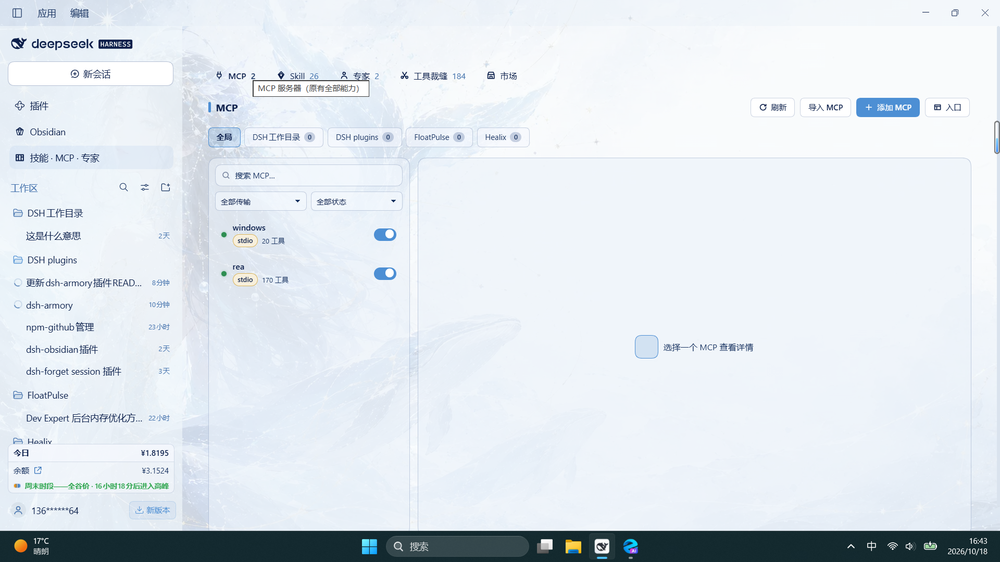
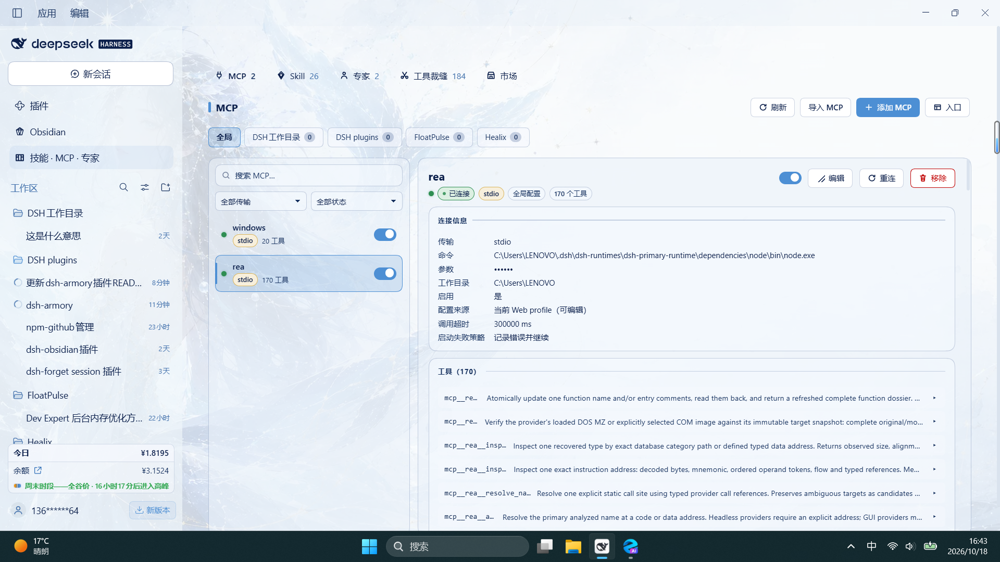
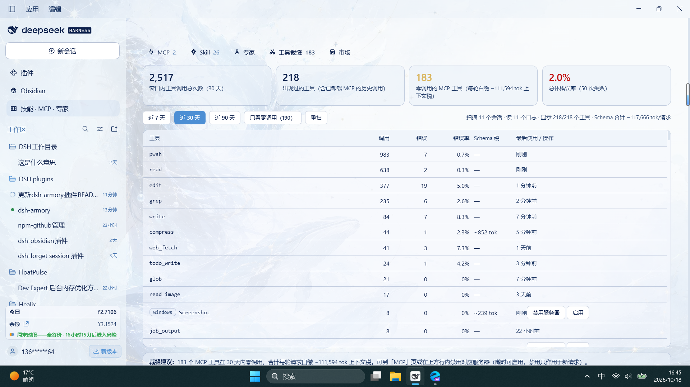
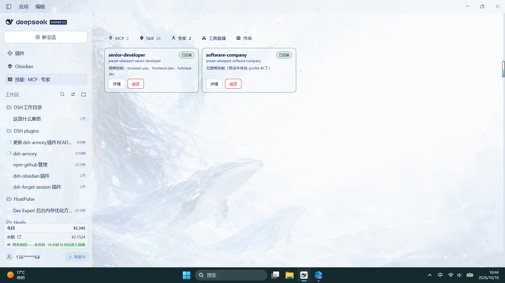
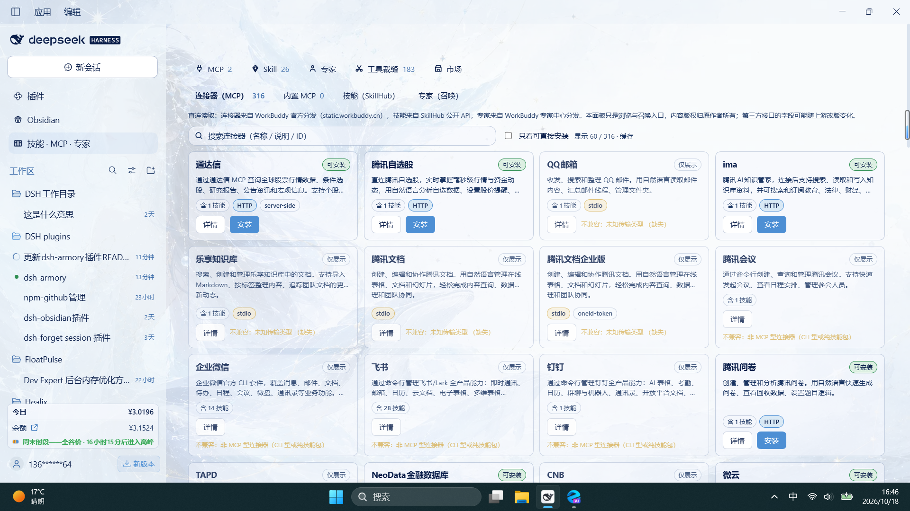
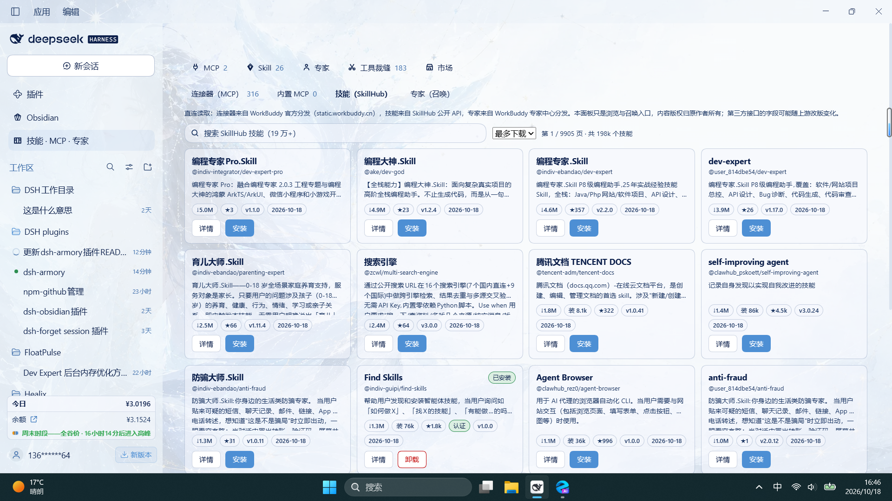
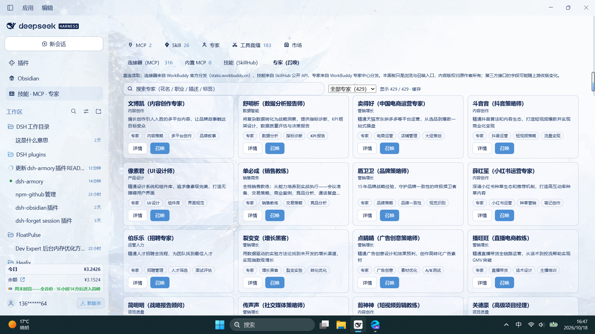

# dsh-armory — 军械库 / Armory

中文 | [English](README.en.md)

> **DeepSeek Harness 的一体化管理看板**：MCP · 技能 · 专家 · 插件 · 工具账本 · 四大市场，浏览、搜索、一键安装、一键召唤。
> fork 自 [Imzl-zl/dsh-mcp-manager-ui](https://github.com/Imzl-zl/dsh-mcp-manager-ui)（MIT），现已扩展为完整军械库。
>
> **最新 v2.4.0**：Skill 看板回答「什么时候装的、哪个是刚装的、它就是市场里那个吗」——卡片显示安装时间（7 天内高亮），筛选条新增「最近安装」时间线，看板名与市场原名不一致时标出原名。详见 [更新日志](.github/release-notes/v2.4.0.md)。

<p align="center">
  <a href="https://github.com/2026heshao/dsh-armory/stargazers"></a>
  <a href="https://github.com/2026heshao/dsh-armory/releases"></a>
  <a href="https://www.npmjs.com/package/dsh-armory"></a>
  <a href="./LICENSE"></a>
  
  <a href="https://github.com/topics/dsh-plugin"></a>
</p>

## 一键安装

```sh
# npm（推荐：免构建授权，装完即用）
dsh plugin --profile web add dsh-armory

# GitHub
dsh plugin --profile web add github:2026heshao/dsh-armory
```

装完**重启 DSH**，侧栏顶部「全局面板」里点 **技能 · MCP · 专家**（或右下角悬浮按钮）。桌面端装在 `desktop` profile 时把 `--profile web` 换成 `--profile desktop`。

## 它解决什么

| 痛点 | 本插件的做法 |
|---|---|
| MCP 配置要手改 YAML，改完不知道连没连上 | 可视化面板：状态、工具 Schema、启停、重连，全局与项目双作用域，项目级改完即对存活会话生效 |
| 装技能要去各处翻 `SKILL.md` 仓库 | **市场直连**：SkillHub 19 万+ 技能、WorkBuddy 316 个连接器，搜索/筛选/一键安装，逐文件 sha256 校验 |
| 在市场装了技能，回看板却找不到，也分不清哪个是刚装的 | **技能安装可辨识**：卡片标「装于 …」，7 天内高亮并给相对时间；筛选条按安装时间倒序成「最近安装」；看板名与市场原名不一致时标出「来自市场 原名」 |
| 每个 MCP 的工具描述都在吃上下文 token，零调用的工具白白占位 | **工具裁缝**：扫描本机会话日志统计每个工具的调用/错误/延迟，并给出技能维度的使用账本；死工具清单一键禁用 |
| 从 Claude/Cursor/VS Code 迁移要逐条抄配置 | 自动检出 11 种客户端的本机配置，预览后一键导入 |
| 插件散在宿主自带与社区清单两处，格式与可装性各不相同 | **插件页**：把 DSH 社区清单一并呈现并标明可装性（宿主自带组件单独标注），安装统一走宿主 `pluginManager`，装完明确提示需重启 |
| 远端 MCP 要 OAuth，而官方 client 只认静态 headers，只能手搓 token | **一键授权**：按 RFC 9728/8414/7591/7636/8707 走完发现 → 注册 → PKCE → 回调 → 换 token，回调通道三级降级（loopback / 粘贴回调地址 / 手贴 token），到期自动刷新 |
| 装过的连接器、插件，过几天忘了是从哪来的 | **安装状态账本**：`~/.dsh/armory/install-state.json` 记录每条的来源市场，市场页可跨页筛出已安装项，并把「本插件装的」与「别处手动配的」分开 |

## 界面预览

看板五个主要分类页各一张（Windows 桌面端实拍，浅色主题）。2.0.0 新增的「插件」页与 OAuth 授权流程暂无截图：

### MCP — 全局管理面板

全局 / 项目双作用域切换，行内启停；全局与各项目之间可以同名共存、各自独立连接：



### MCP — 连接详情

传输方式、连接参数、调用超时、配置来源一目了然，下方是该服务器注册的工具清单（本例 170 个，展开可看完整输入 JSON Schema）：



### 工具裁缝 — 工具使用账本

30 天窗口四张指标卡（调用总次数 / 出现过的工具 / 零调用 MCP 工具 / 整体错误率），逐工具列出调用、错误、错误率、Schema 上下文税与最后使用时间，底部常驻裁缝建议。默认显示全部工具与真实调用次数，需要时点「只看零调用（N）」收窄。指标卡下方是**第二条趋势**：按天采样日志里每次请求真实下发的工具清单（`request/header`）并算出它的税，同时给出「窗口内下发清单变过几次」和最近一次的时间；说明栏还会在本机日志短于所选窗口时直接印出「窗口 N 天，读到的调用记录只跨 M 天」，让「数字几天没变」这件事在屏幕上就能归因：

工具表下方新增**技能账本**：按 `skill` 工具调用参数里的技能名统计调用 / 错误 / 最后使用，并把当前注册表中零调用的技能补成 0 行——哪些技能注册了却一次没被调用，一眼可见。参数里没有技能名的调用单独计数上屏；注册表不可用时只列出日志里出现过的技能，不伪造 0。



### 专家 — 已召唤清单

每个召唤的专家 / 专家团一张卡片：绑定技能、详情、送还；团队型专家在详情弹层里有「团队编制」区块（每位成员的职责与人设路径）：



### 市场 — 三处直连

连接器（WorkBuddy 官方分发 316 个；可安装的标「可安装」，CLI 型 / 需 token 注入的如实标「仅展示」并给出原因）：



技能（SkillHub 公开 API，19 万+ 技能；搜索 + 排序 + 分页，已装的标「已安装」可一键卸载）：



专家（WorkBuddy 专家中心 429 位 / 15 个行业；分类筛选 + 关键词搜索，卡片直接「召唤」）：



## 功能

- 查看每个 MCP 的状态、传输方式、连接参数与工具列表；展开工具可看完整输入 JSON Schema（必填/可选、类型、枚举、默认值与原始 JSON）
- 按传输方式（HTTP/stdio）与状态筛选，按名称/命令/URL 搜索
- 启用、禁用、重连、添加、编辑、移除；需要时用眼睛临时揭示被掩码的凭据并一键复制
- **全局 + 项目双作用域**：全局写 Web profile，一次注册所有项目可用；项目写该项目 `.dsh/mcp.json`，只该项目会话可见；项目里还能「屏蔽」某个全局 MCP
- **两个入口，同一个面板**：右下角悬浮按钮（可拖拽、记忆位置）与官方侧栏入口（展开态在「设置」上方显示「MCP」，收起成 56px 轨道时只剩图标）共享同一开关状态；面板右上角「入口」可以把两者只留一个（不能都关）
- 导入本机其他客户端的 MCP 配置：自动检测 Claude Code、Codex（`config.toml`）、OpenCode（含 `.jsonc`）、pi、Claude Desktop、Cursor、Windsurf、VS Code、Gemini CLI、Roo Code 与跨工具的共享配置，逐个列出，点一条即导入；也能粘贴 Claude/Cursor/Cline/Roo 的 `mcpServers` 或 VS Code 的 `servers` JSON。写入前预览，支持「合并（同名更新）」与「替换」
- 跟随 DSH 深色/浅色主题，适配窄屏与移动宽度
- 更新提示与**一键升级**：有新版时在面板顶部显示可关闭的提示条（每天最多查一次，可用 `DSH_ARMORY_DISABLE_UPDATE_CHECK` 关闭）。点了「升级」才动，**不会自动升级**；升级由 DSH 官方的 pluginManager 执行，装完提示重启宿主生效。用 `link:` / `file:` / `github:` 装的本地开发副本不给按钮（那会把链接换成 npm 包）
- **升级后主动说一次变了什么**：版本变了后第一次打开面板弹一张小卡片，列出本次更新内容，并指路新功能在哪（例如「入口」开关在面板右上角）；确认一次后不再提示，不联网、不发任何数据
- **工具裁缝**（1.7.0 新增）：扫描本机会话日志（解析 `tool/call` / `tool/result` / `request/header` 三类事件，不读消息正文），统计每个工具近 7/30/90 天的调用次数、错误率与最后使用时间；上下文税给**两个口径**——按当前注册表估算的 Schema 快照（它是 Schema 长度的纯函数，只有改动注册表才会变），以及按天采样 `request/header` 得到的每轮真实下发清单税，两者差额非零时说明栏指出「改了没生效 / 线上下发的比注册表多」；窗口内零调用的 MCP 工具自动进「死工具清单」，行内可一键禁用/启用对应服务器（复用官方写链，随时可恢复）。**默认显示全部工具与真实调用次数**，零调用的行以底色标出；想只看死工具时点「只看零调用（N）」切换。顶部说明栏常驻回显「显示 N/M 个工具」，避免筛选态被误读成「所有计数都是 0」；本机日志覆盖不足窗口天数、或有条目缺时间戳（`undatedCalls`）时也在这里显形，不再静默。账本缓存行只读（「清空缓存」按钮已删——实测既不回收空间也不修任何事）。全程只读，多帧 zstd 日志逐帧解析、个别帧损坏跳过不中断
- **WB 市场（直连安装，1.8.0 新增）**：看板第四个分类，两个市场一处浏览——
  - **连接器（MCP）**：直读 WorkBuddy 官方分发 ZIP（`static.workbuddy.cn`，与 WorkBuddy 桌面端同一数据源），316 个连接器按需解析；可安装的 242 个（streamable-http 为主），CLI 型 / 需 WorkBuddy token 注入的 74 个如实标注「仅展示」并给出原因。安装 = 把该连接器的 `mcpServers` 合并写入 MCP 配置，与「导入 JSON」同一链路（准入、同名跳过、entry id 预留一致），全局与项目作用域都可选；ZIP 按 ETag 缓存在 `~/.dsh/wb-market/`，解压用 Node 内置 zlib，**零新增运行时依赖**
  - **技能（SkillHub）**：直读 SkillHub 公开 API（`api.skillhub.cn`，19 万+ 技能），支持搜索（`keyword`）、排序（下载/安装/星标/评分）、分页；详情含发布方认证与安全扫描状态。安装 = 逐文件下载并按清单 sha256 校验后写入 `~/.agents/skills/`（与官方 skill 子系统同一发现范围），装完即刻生效；已装的显示「已安装」，可一键卸载、重装即更新。下载量排序在**当前页内**本地完成（上游 `sortBy=downloads` 现在会挂起），其余排序照常走远程；单次请求 15 秒超时，超时文案已中文化
  - 技能版权归原作者所有；两个均为第三方接口，字段可能随上游改版变化（面板顶部有常驻说明）
- **专家直连（1.9.0 新增，体验对齐 WorkBuddy 专家中心）**：看板独立分类「专家」（侧栏入口同步更名「技能 · MCP · 专家」）——
  - **目录**：直读 WorkBuddy 专家中心官方分发（`expert_center.json`，429 位专家 / 15 个行业分类，ETag 缓存在 `~/.dsh/wb-market/experts/`），分类筛选 + 关键词搜索 + 详情弹层（召唤前看人设正文、捆绑技能、试试这样问）
  - **召唤** = 往 profile 补丁写入一条**独立 Agent 预设**（`@deepseek-ai/dsh-agent-preset` 行，plugins 复刻内置 standard 预设、仅 persona 的 prefix 换成专家人设全文）——新建会话时选择「WorkBuddy 专家 · …」即专家接管该会话，标准工具/规划/压缩/委派原样保留；多个专家可共存，写入走既有 patch 写链（文件锁 + 版本校验 + 原子写），其余条目、注释与 `!!js` 表达式原样保留
  - **捆绑技能**：召唤时可勾选一并安装——本机 WorkBuddy 缓存（`~/.workbuddy/plugins/cache/experts/`）有完整技能树就整目录复制到 `~/.agents/skills/`（`wbexpert__` 前缀，即刻被技能注册表发现）；无缓存时按 CDN 的 SKILL.md 单文件兜底并如实标注来源
  - **团队型专家（1.9.4 可召唤）**：WorkBuddy 的 53 个「专家团」人设原本依赖 `TeamCreate` / `Agent(name=…)` 两个 DSH 没有的工具。召唤时除了写主理人预设，还会把每位成员的人设各自落成一份文件（`~/.dsh/wb-market/experts/teams/<专家>/`），并在主理人人设末尾追加一段**运行时适配**：建团队 → 无需调用（编制已在召唤时固定）；派活 → `subagent`（先把该成员人设 `read` 出来拼进 prompt），顺序 SOP 传 `run_in_background: false` 当场等结果；续聊用 `send_message`。原人设的铁律（不得代写成员产出、成员之间不直连、一切经主理人中转）原样保留。成员人设**不进系统提示**（否则每轮都要为 5 份人设白付上下文费），只在调度时按需读取
  - **送还** = 摘除该召唤预设、对应技能目录与团队成员人设（热加载，无需重启）
- **召唤菜单（会话内快速调用，1.9.3 增强）**：会话输入框工具行右侧的看板小图标 → 「技能 / MCP / 专家」三分类，悬停展开子菜单，点一条即把引用写进输入框（技能 = `/技能名`、MCP = 点名 `mcp__服务__*`、专家 = 挂到当前会话）——
  - **每屏 6 行 + 滚动**：子菜单一次显示 6 条，超出的往下滚（细滚动条跟随主题）；「管理技能 / MCP / 专家…」固定在底部，不被列表滚走
  - **最近使用置顶**：刚用过的条目自动排到最前并带「最近」标记，其余保持原有顺序；最近使用记录池 40 条
  - **专家随时挂 / 换 / 摘**：点一个专家即接管当前会话（包括已经聊了一半的），再点别的直接替换，点 chip 的 × 立刻取消；**只影响这一个会话**，不动工具目录、不写任何持久化配置
  - **显示与实效一致**：挂专家后，会话标题栏显示的始终是**当前真正生效**的专家（宿主那条「会话创建时的预设」标签在挂载期间自动让位）；三处显示（标题栏徽章、输入框 chip、菜单）挂/换/摘后同帧同步
- **插件市场（2.0.0 新增；2.3.x 只保留 DSH 社区）**：新增「插件」页，直连 `awesome-dsh-plugins` 社区清单，可搜索、可筛选，每条标明可装性——
  - **DSH 社区**：`awesome-dsh-plugins` 社区清单（单文件裸 JSON、五千余条，jsdelivr 主源 → fastly 备源），拉取后瘦身到 `SLIM_MAX_BYTES = 3MB` 再落缓存；更新检测先经 GitHub API 把 `main` 解析到最新提交 SHA、再按 `@<SHA>` 不可变地址取数（绕开 jsdelivr 对分支地址的 12h CDN 缓存，API 不可达时回落分支地址 + ETag 条件请求）
  - **社区双源聚合（2.3.x）**：在 `awesome-dsh-plugins` 之上聚合第二社区注册表 `awesome-dsh-plugin.com`（CC0，经其 npm 包 `dsh-plugin-catalog` 分发，jsdelivr 主备镜像）——只并入其 **npm 可装** 条目（git-only 不进面板），按 npm 包名与主源去重、主源优先，面板目录 ~7.2k 条且全部可安装；取数走「registry 解析 latest 版本号 → jsDelivr `@<版本>` 不可变地址」（与主源 SHA 机制同构），两源并行拉取、各自独立容错，任一源挂掉只少一块、不拖垮面板
  - **宿主组件**：清单内属于 DSH 宿主官方分发的条目（`@deepseek-ai/` 前缀）标注「宿主组件」，随宿主本体分发，不提供安装
  - **安装**：统一走宿主 `pluginManager.installBundle` 拉取落盘，**装完需重启 DSH 宿主才生效**；宿主无 `pluginManager` / 条目无 npm 包名 / 宿主组件三种情况各自给出明确文案，不静默失败
- **MCP OAuth 一键授权（2.0.0 新增）**：官方 `@deepseek-ai/dsh-mcp-client` 的 transport 只认 `requestInit.headers`、没有 authProvider，所以 OAuth 必须在**安装前**由本插件跑完，把 `authorization: Bearer <token>` 静态写进 patch 的 headers，此后由本模块负责刷新——
  - 按 **RFC 9728**（受保护资源元数据）→ **RFC 8414**（授权服务器元数据）→ **RFC 7591**（动态客户端注册）→ **RFC 7636 PKCE**（只发 S256）→ **RFC 8707**（`resource` 参数）逐条实现
  - 回调通道**三级降级**：本地 `127.0.0.1:<随机端口>/callback` 自动收 code（主流实现）→ DCR 只接受自定义 scheme 时提示「粘贴完整回调地址」→ 都不通则直接「粘贴访问令牌」
  - 服务器返回 401 时自动弹出「授权 {服务器}」对话框并打开浏览器，无需用户先去找入口
- **安装凭据引导（2.0.0 新增）**：安装前扫 `mcpServers` 里的 `${...}` 占位符，弹「填写 {连接器} 的凭据」逐槽填写后「带凭据安装」；留空表示稍后自行补全，装完提示「另有 N 个占位符未填写，配置里保留原样」；无占位符的连接器直接放行
- **安装状态账本（2.0.0 新增）**：`~/.dsh/armory/install-state.json`（`INSTALL_STATE_VERSION = 1`）记录每条连接器 / 技能 / 插件的 `source {marketplace, url, kind}`，市场页据此支持**跨页**筛出已安装项（技能侧仍只筛当前页，两处文案分别说明），并把「本插件装的」与「别处手动配的」分开；登记失败不影响安装，只补一句提示
- **技能看板分类（2.0.0 新增）**：技能按 **编程开发 / 设计与创作 / 文档办公 / 效率与自动化 / 开发运维 / 未分类** 六类归置，网格与列表双视图可切、可按分类过滤，常驻「显示 N / M 个 skill」；详情新增所属分类、来源目录、文件位置，可一键「复制 SKILL.md 路径」「复制 @会话引用」
- **技能卸载（2.2.0 新增）**：用户级 / 项目级目录里的 skill 可在详情里直接卸载（就地二次确认、**永久删除且不可撤销**）；随 DSH 分发、运行时注册与自定义目录的 skill 只读，并说明不在可卸载范围内。宿主本身只提供读取接口，卸载由本插件的 `removeSkill` 完成：来源白名单 → 根目录严格包含性 → 父目录 realpath → 符号链接只 unlink 不碰目标 → 目录必须含 `SKILL.md` 且在根内
- **技能集合实时刷新（2.2.0 新增）**：市场安装 / 卸载技能、看板自己卸载，三处都会向模块级变更总线广播；顶部 **Skill** 数量角标与看板列表订阅同一条总线，各自重读真值，角标重取带序号守卫，快速连点也不会被乱序回包回滚。装完 / 卸完立刻对新集合，不必切页或重开面板
- **技能安装可辨识（2.4.0 新增）**：Skill 看板每张卡片 / 列表行显示「装于 …」——7 天内绿色高亮并给相对时间（「3 小时前装」），30 天内显示「N 天前装」，更早给绝对日期。时间优先取安装状态账本登记的首次安装时间，其次目录创建时间，最后目录修改时间；随 DSH 分发 / 运行时注册的技能没有安装事件，不显示徽标。筛选条新增「最近安装」时间线，按安装时间倒序平铺；看板名（取自 `SKILL.md` 的 `name:`）与账本登记的市场名不一致时，卡片出现「来自市场 原名」徽标，详情面板新增「市场原名」行。数据由新增 RPC `skillInstallInfo` 提供（宿主自扫标准技能根目录、只读每个 `SKILL.md` 头部 4KB 解析 `name:`），宿主需重启一次才注册；未注册时看板显式提示，不静默
- **自定义套件（2.2.0 新增）**：把常一起用的 skill 打包成「套件」——Skill 看板工具栏的「套件」打开管理窗，左侧挑技能、右侧编排（点 **+** 或拖入添加，拖拽排序，删除就地二次确认），一次保存即整集合覆盖落盘到 `~/.dsh/armory/suites.json`（staging + rename 原子写，坏数据拒绝且原文件不动）。输入框召唤菜单的「技能」子菜单顶部会出现套件分组，点一次就按成员顺序把多个 `/name` 一并插进草稿。上限 100 个套件 / 每套 40 个成员；成员按各自的技能名进「最近使用」，不会把套件名记成一条孤立记录
- **多市场注册表（2.0.0 新增）**：市场源不再硬编码，落 `~/.dsh/armory/marketplaces.json`（`REGISTRY_VERSION = 1`），缺失或损坏回落内置默认项、首读即落盘，支持增删改；写盘一律 staging + rename 原子替换
- **社区目录秒开（2.0.0 新增）**：上次成功的精简清单镜像进浏览器 `localStorage`（7 天 / 4MB 上限，超配额保留旧快照），首屏先渲染快照再被真实结果静默替换（0 网络 0 IPC）；源不可达时明说「显示的是本地缓存」而非给空列表
- **插件市场加载提速（2.3.0 优化）**：社区目录预取 + 分层缓存，切到「插件」页不再等一次完整请求——
  - **目录预取**：市场面板挂载 400ms 后后台读取社区目录；首屏命中浏览器快照（见上）时直接渲染，点进插件页通常已经就绪
  - **可点击提示**：有打开 README 行为的插件卡片统一 `cursor:pointer`，hover 用强调色描边，键盘聚焦有 `:focus-visible` 轮廓，Enter / Space 可打开；卡片内「安装」按钮阻止冒泡，不会连带打开卡片
  - **卡片排版（2.3.0 优化）**：DSH 社区插件卡片拆成五条固定水平线——32px 头像 + 单行标题、官方 / 仓库一行、两行摘要 38px、最多三个标签 18px、页脚 38px（星标 + 核验日期 + 安装）——整卡固定 **176px**，同一行按钮落在同一水平线。验证版本收进图标 tooltip，作者只出现一次；头像失败回落首字母；已安装与宿主组件在页脚标明。只作用于社区插件卡，连接器 / 技能 / 专家卡不变
- **社区 README 预览（2.1.0 新增）**：点开「插件 → DSH 社区」任意卡片，即就地拉取并渲染该仓库 README（标题 / 段落 / 列表 / 表格 / 代码块 / 引用，含 `<p align="center">` 横幅）——
  - **按需、只取一次**：README 不进目录的瘦身缓存，点开才拉；按 `README.md` / `readme.md` / `Readme.md` / `README.MD` / `README.markdown` / `README_EN.md` 顺序试；仓库填的是 npm 包名时，先问 `registry.npmjs.org` 取 `repository`，拿到再去 GitHub 取原文
  - **限额与缓存**：单次 20s 超时、正文 16 万字符上限（超了截断并在界面标注）；取到后按「仓库或 npm 包名」落盘缓存 7 天，同一插件再点秒开，断网 / 限流 / 仓库被删回落缓存并标明「这是缓存」
  - **图片与安全**：`http(s)` 图片过 `wsrv.nl` 只读代理（`output=webp&q=72&w=880`，仅对白名单主机生效），相对路径按仓库地址还原成绝对 URL、还原不了就跳过；正文由自写解析器生成 React 元素，**不碰 `dangerouslySetInnerHTML`**，`javascript:` / `data:` / `vbscript:` 伪协议链接一律降级成纯文本
  - **长文跳转**：弹层右下角常驻「跳到末尾」按钮（sticky 在弹层内，滚动时不消失，键盘可聚焦），点一下平滑滚到 README 底部；贴底时按钮排在「关闭 / 安装 / 重新读取」之后，不会盖住操作行
- **社区目录与更新探测修正（2.1.0）**：秒开快照不再顶掉真实目录（此前快照一渲染真实结果就被丢弃，目录于是一直停在旧快照）；更新探测与目录改走同一条源链（先问这份缓存实际来自哪个源、再兜底其余源，首个拿到 ETag 的源胜出），修掉「主源不通的机器上目录能开、点检查更新却每次 `probe-failed`」
- **谁在做、还在维护吗（2.3.0 新增）**：市场卡片先给一层不联网的「人」信号——发布方头像 / 名称与最近更新日期（技能看 SkillHub 发布方或 GitHub 仓库 owner，插件与社区条目看仓库 owner，专家看目录自带头像与更新时间）；打开详情再按需查一次 GitHub 公开接口，补上维护者主页、最近提交、开放 issue 数、Star、License、主语言，并用标签直说「近 30 天有提交 / 超过半年未更新 / 已归档」。请求按 6 小时缓存与 ETag 复用，单次最多 8 个仓库，未认证限流时回落旧缓存并标明；查不到只收起这一行，不阻塞详情正文
- **最近动静（2.3.0 新增）**：市场页顶部有一条只属于这台机器的时间线——对比「上次成功读取目录」与「这一次」的新增、移除、版本或核验状态变化，并标出条目名与相对时间。它不联网、不埋点、不伪造在线人数或实时消息；没有变化就直说「暂无新变化」。事件 7 天过期、最多保留 8 条，可一键清除；技能只在默认页 / 无关键词 / 默认排序时记录，翻页与搜索不会制造假动静
- **装备清单（2.3.0 新增）**：市场页右上「装备清单」把本机的 MCP、技能、专家与插件导出成一份可分享的 JSON——只含名称、类型、来源、版本与必要的身份字段，**绝不写入密钥、header、URL 查询参数或环境变量的值**，技能正文与专家人设也不进清单。朋友发来的清单可以粘贴或选文件导入，面板按 `已安装 / 可更新 / 本机没有` 三态逐项对比，`去市场` 只负责跳到对应市场并带上搜索词，**不自动安装、不自动写配置**。上限 200 条 / 256KB，超限截断并标注
- **找到真实的人（2.3.0 新增）**：详情底部给出真实出口——能解析到仓库的，给出去仓库、看讨论 / 提 Issue；有来源主页的，给出源站；任何条目都可以「向军械库反馈」（预填 GitHub Issue），或先复制反馈模板（条目、类型、来源、版本、环境）自己改完再发。所有链接在新标签页打开，内容先由用户过目、确认后才提交。**刻意不做站内论坛、点赞或收藏**：社区在哪，就把人送到哪，而不是在插件里搭一个没有人的布景

## 安装

```sh
# 从 npm 安装（推荐）
dsh plugin --profile web add dsh-armory

# 从 GitHub 安装
dsh plugin --profile web add github:2026heshao/dsh-armory
```

装完**重启 DSH**（桌面端重启应用，Web 端重启 `dsh web`；桌面端把 `--profile web` 换成 `--profile desktop`）。升级：npm 安装可在面板「一键升级」提示条上直接点，GitHub 安装换新版 tag 重新 `add`。卸载（不会删除 profile 里已有的 MCP 条目）：

```sh
dsh plugin --profile web remove dsh-armory
```

细节、本地开发安装与故障排查见 [安装与升级](docs/installation.md)。

> 不要把 `dsh-armory` 手工插进 profile 的 `cordis.patch.yml`、Agent preset 或额外的 `--patch` 文件——插件命令已经完成这件事，重复装配会明确报错。

## 使用

### 打开面板

两个入口，同一个面板：

- **右下角悬浮按钮**：可拖拽移动，位置会被记住；
- **侧栏「技能 · MCP · 专家」**：展开态在「设置」上方，侧栏收起成 56px 轨道时只剩图标。

面板浮在会话之上，关掉它（右上角「关闭」或 Esc）不会影响会话。

两个入口都能单独关掉：面板右上角「入口」里选 `悬浮按钮 + 侧栏入口`（默认）/ `仅悬浮按钮` / `仅侧栏入口`。**不能两个都关**——面板只能从这两个入口打开，所以这是一个三选一，而不是两个独立的开关。选择存在浏览器本地（localStorage），换浏览器或清缓存要重选一次。

### 全局 vs 项目

顶部标签页在「全局」与各项目之间切换：

| 标签页 | 存哪 | 谁可见 | 改动何时生效 |
|---|---|---|---|
| 全局 | Web profile 的 `cordis.patch.yml` | 所有项目 | DSH 热加载，通常立即生效 |
| 某项目 | 该项目 `.dsh/mcp.json` | 只该项目会话 | 写盘即生效（见下） |

`serverName` 按作用域判重：不同项目之间、全局与项目之间**可以同名**，各自独立连接；同一作用域内不能重名。

### 常用操作

在列表行或详情页里：

- **开关**：启用 / 禁用（全局写 profile 补丁的 `disabled`，项目写 `.dsh/mcp.json`）；
- **重连**：全局条目重载 loader 条目；项目连接会拆掉旧连接、按当前配置重建并重新投射给存活会话（`mcp-client` 的重连预算耗尽后必须靠它恢复）；
- **编辑 / 移除**：移除只影响当前作用域；
- **屏蔽**（项目页里对全局 MCP）：写 `exclude`，该项目的新会话不再看到它——全局实例仍在跑，所以不影响其他项目。

### 添加 MCP

两条路，都从面板顶部工具栏进：

1. **添加 MCP**：表单填 `command`/`args`/`env`/`cwd`（stdio）或 `url`/`headers`（HTTP），可设调用超时、启动失败策略与重连策略；常用服务器有预设模板可一键套用。
2. **导入 JSON**：粘贴其他客户端的配置，先预览再写入。支持「合并（同名更新）」与「替换」，字段映射与限制见 [JSON 导入](docs/json-import.md)。

### 看工具与敏感值

详情页列出该 MCP 当前注册的工具；展开可看完整输入 Schema。凭据类字段默认掩码，点眼睛图标会向 Host 读取**有效运行值**（已解析过的环境变量）并临时显示，再点一次恢复；已显示的值可一键复制。编辑时若没实际改动输入，保存仍保留原来的引用写法，不会把密钥写回配置文件。

## 配置生效时机（重要）

| 作用域 | 修改后何时生效 |
|---|---|
| 全局 | DSH 热加载，通常立即生效（含运行中的会话） |
| 项目 | **写盘即生效**：新增立刻挂上存活会话、删除立刻撤掉工具、改动就地重载连接（工具名不变） |

项目 MCP 由本项目所有会话共用一份连接，配置写在 `.dsh/mcp.json`。面板保存的那一刻就会对齐到正在运行的会话，**不需要重开会话，也不需要重启 Host**；手工编辑该文件则在**下一次会话挂载**时被采纳。

> **连接跟配置走，不跟会话走**：最后一个会话结束不会拆掉连接，它只进入空闲等待，下一次会话直接复用——这样"要用的时候"它已经就绪（这也是宿主自己的契约：工具必须在首轮之前出现）。两个旋钮写在 server 条目里：`idleTimeoutMs`（空闲保留多久，默认 5 分钟，`0` = 永不回收）与 `readyTimeoutMs`（挂载时等就绪的总预算，默认 5s，`0` = 不等）。字段速查与边界见 [设计与限制](docs/design.md#项目级专有字段dshmcpjson-里每个-server-可写)。
>
> **状态怎么看**：项目行把两件独立的事分开说，不合成一个状态。
> - **连接在不在**：`已连接 · 当前无会话使用（连接保留，下次直接用）` / `已连接 · N 个会话在用` / `连接中…` / `连接失败` / `尚未建立连接（新会话自动挂载）`。
> - **几个会话在用**：见上一行的 `N 个会话在用`；不再出现「待会话挂载」那种把两者压成一句、容易被读成"还没连上"的写法。
>
> **重连是必需出口**：mcp-client 的自动重连有次数上限，耗尽后它会注销工具并停止，只能靠重载配置或重启宿主恢复（它的 README 明写）。项目 MCP 又不是常驻服务，所以面板的「重连」按钮会拆掉旧连接、按当前配置重建，并重新投射给存活会话。

## 常见问题

**面板里显示「已禁用」，但模型调用报 `unknown tool "mcp__xxx__..."`**
那个 MCP 被禁用了，所以它没有注册任何工具。在面板里点「启用」即可（全局会写 profile 补丁并热加载，项目写 `.dsh/mcp.json`、写盘即生效）。

**那一行显示「挂载失败」「连接失败」或「作用域隔离失败」，怎么区分？**
三类是不同的事，详情页会给出具体原因：**挂载失败** = **会话挂载阶段**（`agent/created` 监听器）就没挂上（变量求值为空、`failOnStartupError` 下启动失败、工具注册被拒）；**连接失败** = `mcp-client` 连不上或重连耗尽（原因取自它的日志）；**作用域隔离失败** = 连接正常但工具不在共享作用域层（宿主里出现了两份 `@deepseek-ai/dsh-scope`）。排查与原理见 [设计与限制](docs/design.md#连接状态语义)。

**项目行那些状态文案分别是什么意思？**
它们把两件独立的事分开说：**连接在不在** —— `已连接 · 当前无会话使用（连接保留，下次直接用）`（最后一个会话结束了，连接按空闲策略留着）/ `已连接 · N 个会话在用 · M 工具` / `连接中…` / `连接失败` / `尚未建立连接（新会话自动挂载）`；**几个会话在用** —— 就是那句里的 `N 个会话在用`。旧版本的「待会话挂载」正是把这两件事压成一句，所以容易被读成"还没连上"。

**怎么升级？为什么面板没提示？**
从 npm 装的直接 `dsh plugin --profile web update dsh-armory` 就会升小版本，也可以直接点面板提示条上的「升级」（同一件事，免去敲命令）。面板的提示条只查 GitHub Releases、每天最多一次、可关闭、不会自己动；固定 tag 安装的用户不会自动跨版本，需要用新 tag 重新 `add`（见 [安装与升级](docs/installation.md)）。

**改动会不会碰到我的其他配置？**
不会。全局改动只动 profile 补丁里由 `@deepseek-ai/dsh-mcp-client` 声明、且由本插件管理的条目，保留其他插件条目、注释与 `!!js` 表达式；导入「替换」也只替换这一部分，不会删除其他 bundle 或 Agent preset 自带的 MCP。

**卸载后我配置的 MCP 会消失吗？**
卸载插件不会删除 profile 里已有的 `@deepseek-ai/dsh-mcp-client` 条目；项目的 `.dsh/mcp.json` 也留在原处（它本来就是普通 JSON 文件）。

## 界面语言

插件提供中文（源语言）与英文两种界面：

- **优先级**：`localStorage['dsh-armory.locale']`（显式覆盖）→ DSH「设置 → 通用」里的语言 → 浏览器 `navigator.language` → `zh-CN`。
- **回落规则**：`zh*` 显示中文，`en*` 显示英文；其他语言（`ja` / `de` / `fr` 等）目前没有译文，统一回落英文，而不是把中文丢给看不懂的用户。
- **覆盖范围**：面板 UI、按钮 / 对话框 / 空状态、升级后的「本次更新」正文与功能指路。
- **不翻译**：连接器、技能、专家、社区 README 等第三方内容保持发布方原文。
- **强制英文**：在 DevTools 执行 `localStorage['dsh-armory.locale'] = 'en-US'` 后刷新；删除该键即重新跟随 DSH 语言。宿主设置的英文在中文系统上同样生效（不再依赖浏览器语言）。

## 兼容性

| 项目 | 已验证 |
|---|---|
| DeepSeek Harness | `0.1.5-rc.1` 及以上（已验证至 `0.2.1-rc.2`，DSH 44.7.0） |
| Node.js | DSH 自带/支持的运行时 |
| 平台 | Windows；Linux/macOS 使用同一 DSH Web 契约 |

只支持 0.1.5 起（更早的版本缺少「按注册作用域判 `serverName` 唯一性」与「setup 传入 agent」两个能力），不为旧版本保留降级分支。原因与依赖细节见 [设计与限制](docs/design.md#兼容性与依赖细节)。

## 开发

```sh
npm install --no-save yaml@2 eslint@9   # 测试与风格检查的唯一裸依赖（运行依赖全部由宿主提供）
npm test                                # 全 42 套件（与 CI / 发版门槛同一条）
npm run lint                            # ESLint：no-undef / no-unused-vars / no-empty 等
npm run test:e2e                        # 可选：用宿主补丁算法验证专家预设进入组合树
dsh --profile web --dump-config         # 看 profile 的有效配置
dsh web                                 # 起 Web 做真实操作验证
```

`npm test` 跑的是 `test/run-all.mjs`，依次执行 **42** 个独立套件（各自是独立 node 进程，任一非零退出即整体失败）。套件是显式白名单而非 `node --test` 自动发现——`test/` 下还有带副作用的迁移脚本与需要宿主模块的端到端脚本，自动发现会误跑。

| 分组 | 套件 | 覆盖 |
| --- | --- | --- |
| 账本与配置层 | `tool-ledger` `mcp-config` | 工具账本的 zstd/缓存/尺寸闸门；MCP 配置归一化与 patch 往返 |
| 契约与入口 | `contract-consistency` `client-entry` `host-import-sources` | 面板可调方法必须在 typert 声明 / client 契约数组 / 宿主方法集三处同时存在；三个入口「全关」不可表达；VS Code `${input:}` 降级 |
| 客户端质量 | `client-i18n` `i18n-coverage` `whats-new-i18n` `error-boundary-copy` `persona-truncate` `tailor-window` | 中文皆包 `t()`；en-US 字典双向差集与 zh/非 zh 回落；更新日志英文覆盖逐条对齐（含缺译文回落）；崩溃详情可复制；persona 4000 预览阈值；工具裁缝时间窗四档 |
| 工具裁缝趋势（2.2.0） | `tailor-timeline` `tailor-tax-ui` `tailor-cache-line` | 真实下发税的时间维度与跨度归因（无线上数据必须为 null 而非 0）；裁缝新字段在界面上的接线（vm 真跑源码片段）；账本缓存行只剩读数（「清空缓存」按钮已删，钉住不许复活） |
| 自定义套件（2.2.0） | `suites-registry` `suites-client` | 整集合覆盖 / 幂等 / 拒绝与截断两态；id 归属契约（保存后不分裂）、引用套件展开为多个 `/name`、三级写通道降级 |
| 技能集合（2.2.0） | `skill-remove` `skill-refresh` | 卸载来源白名单与路径边界（根自身 / `..` 穿越 / 跨来源根 / 符号链接只删链接）；装 / 卸后角标与看板实时刷新、乱序回包守卫 |
| 专家与团队 | `run-expert-manual` `session-persona` `team-bridge` `expert-card-actions` `recent-sort-regression` | 专家市场写链（真网目录 + 人设 + patch 往返，33 条断言）；会话级挂/换/摘；团队桥接；卡片按钮真值表；「最近使用」排序 |
| 升级与安装真机 | `upgrade-plan` `verify-install-info` `verify-host-installinfo` `teardown-residue` | 一键升级判据（本地安装 / 来源未知一律不写）；真 profile 数据下的来源判定（profile 不存在自行 SKIP）；teardown 残留诊断 |
| 市场与安装链（2.0.0） | `wb-registry` `wb-install-state` `wb-auth-rules` `wb-connector-meta` `wb-awesome-market` `wb-install-flow` `auth-gate-regression` `install-toast` | 多市场注册表原子写（只剩连接器源，旧 plugins 条目读侧丢弃/写侧拒绝）；安装状态与来源锁；令牌槽扫描与注入规则；连接器 R1/R2/R3 投影；awesome 过滤/瘦身/304/双源切换与更新探测五枚举；令牌替换写链；装前 401 鉴权闸；顶部安装浮层跨卸载可见 |
| 社区信号（2.3.0） | `community-meta` | GitHub 仓库写法解析、单次最多 8 条、6 小时缓存命中不联网、refresh + ETag 的 304 复用、404 文案、网络失败 stale 回落、403 限流跨调用生效、原子写（fetch 全替身 + mkdtemp 隔离） |
| 社区插件卡片（2.3.0） | `market-card-affordance` `plugin-card-layout` | 卡片 pointer 指针 / 键盘可达 / 安装按钮不冒泡（CodeBuddy 卡片与来源切换不得复活）；社区卡片五段固定行高（176px）、标题单行、作者去重、标签最多三个 |
| 装备清单（2.3.0） | `loadout` | 导出字段白名单（env / header / token / url 值、技能正文、专家人设一律丢弃）；导入差异三态 `installed / update / missing`；同名不同 kind 不误匹配、版本缺失不误判 update；200 条与 256KB 上限、截断标记、Windows 文件名净化 |
| 社区与前端护栏（2.1.0） | `awesome-readme` `no-conditional-hooks` | README 仓库解析（npm / GitHub URL 归一）；解析器渲染结构与 `javascript:` / `data:` 伪链接拦截；组件内禁止条件调用 Hook（React #310） |
| 回归护栏 | `readme-images` `bugfix-armory` | README 配图不回退（引用可解析 + `screenshots.json` 与 README 一致 + 旧图名不得复活）；市场入口强制选中与看板页重复让位 |

本机存在 `~/.dsh/profiles/desktop/cordis.patch.yml` 时，`run-expert-manual.mjs` 会追加一组真实 profile 往返断言，没有则记 `SKIP`。

> `auth-gate-regression.mjs` 的被测对象是**运行时副本**（`~/.dsh/profiles/desktop/node_modules/dsh-armory/lib/`），开工前做 SHA256 哈希预检，不符即中止。

CI（`.github/workflows/ci.yml`）与发版门槛（`.github/workflows/release.yml`）跑同两条命令：`npm run lint` + `npm test`，两处口径不许分叉。`release.yml` 另外校验 tag / `package.json` / `lib/whats-new.js` / `.github/release-notes/v<version>.md` 四者版本一致，才 `npm publish` 并建 GitHub Release；发版流程见 [安装与升级](docs/installation.md#发布流程维护者)。

> 本机若没有 `yaml`，`npm test` 会以 `ERR_MODULE_NOT_FOUND` 退出——`test/loader.mjs` 会先试标准解析，失败才回退开发机的 profile 副本（`~/.dsh/profiles/desktop/node_modules`），所以干净环境必须先装依赖。

## 文档

- [安装与升级](docs/installation.md)
- [JSON 导入](docs/json-import.md)
- [设计与限制](docs/design.md)（共享连接模型、连接状态语义、已知限制、依赖细节）
- [DeepSeek Harness 官方插件发布指南](https://github.com/deepseek-ai/deepseek-harness/blob/master/docs/user/develop/basic/publish.md)

## 相关链接

- [LINUX DO](https://linux.do/)（友链）
- [DeepSeek Harness](https://github.com/deepseek-ai/deepseek-harness)
- [GitHub `dsh-plugin` 主题](https://github.com/topics/dsh-plugin)

## License

MIT
