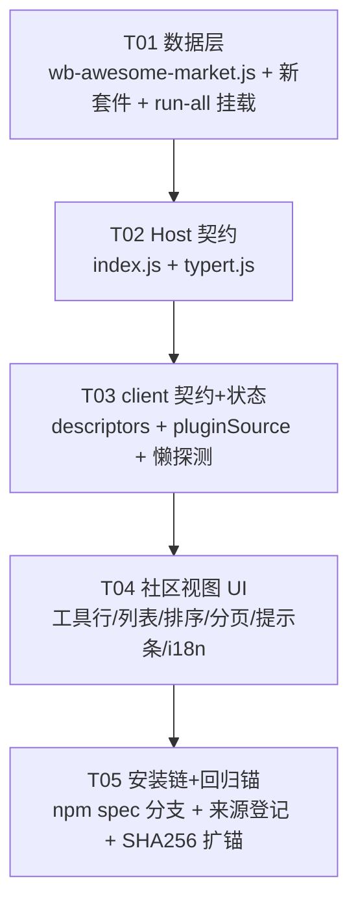

# 增量设计：dsh-armory 接入 awesome-dsh-plugins 插件市场（Awesome Market）

> 架构师：Bob ｜ 2026-10-20 ｜ 输入：`docs/prd-awesome-dsh-plugins.md` v1.1（R11–R20）+ 主理人实测事实清单
> 性质：**增量设计**，不触碰权威文档 `docs/system_design.md`。本文件配套 `docs/sequence-diagram-awesome.mermaid` 与 `docs/class-diagram-awesome.mermaid`。
> 三项用户拍板（绑定，不再重开）：① unverified 403 条不进缓存；② 默认序 stars 降序（featured/official 仅徽章）；③ skill 类 694 条由插件市场承接。

---

## Part A: System Design

### 1. Implementation Approach

#### 1.1 核心技术挑战

| # | 挑战 | 应对 |
|---|------|------|
| C1 | 13.4MB 单文件裸 JSON，无 zip 清单结构，现有 `wb-plugin-market.js` 的 ZipReader 管线完全不适用 | 新建独立 JSON 数据层 `lib/wb-awesome-market.js`，不改造旧管线 |
| C2 | 20,769 条全量数据不可直渲染；P0 收录口径 = verified ∧ 带 npm（≈6 千条） | 一次全量拉取 → 运行时过滤 → 瘦身影射落盘（R11），面板只读瘦身缓存，本地分页/搜索/筛选全即时 |
| C3 | 本机实测 github.com 直连 ❌ / raw.githubusercontent.com ❌，拉取主路径必须避开 | 双 CDN 互切：jsdelivr → fastly（同路径不同 CDN 域，独立故障域）；api.github.com git blobs 兜底**裁定不进 P0**（见 1.3） |
| C4 | 8111 行 client.js 大文件增量，执行子代理（glm-5.3-flash）大文件易失焦 | 任务按文件切片，client.js 操作一律「grep 定位 → read ≤60 行窗口 → edit 定点」，契约条目与 UI 拆成不同任务 |
| C5 | Host Remote 契约三处同步（`lib/index.js` / `lib/typert.js` / `lib/client.js`），缺一即静默 404 | 独立任务 T02（Host 侧）+ T03（client 侧 descriptors），`test/contract-consistency.mjs` 三处子集校验兜底 |
| C6 | 新增 `t('中文')` 必须同步 EN 译文，否则 i18n-coverage 套件红 | T04 任务书内逐条列出新增文案，EN_US_MESSAGES 同步补译 |

#### 1.2 框架与库选择

**零新依赖**（绑定约束）：Node ≥ 22.15 内置 `fetch`（含 `AbortSignal.timeout`）/ `node:fs/promises` / `node:path` / `node:os` / `JSON` 全部够用。13.4MB 单文件 `response.arrayBuffer()` + `JSON.parse` 单次内存峰值 ≈ 40–60MB（Buffer 13.4MB + parse 后对象图），可接受且仅发生在刷新/首载瞬间。ETag 条件请求、双源顺序切换均为既有 `wb-plugin-market.js`（:47-96、:251-291）已验证范式的同构复刻，无第三方需求。

架构模式沿用仓库既有分层：**纯数据层（lib 模块，零 Remote 依赖）→ Host Remote 网关（index.js 薄转发）→ 浏览器半契约（client.js descriptors）→ UI 组件（client.js 内 h() 渲染）**。不引入新抽象层。

#### 1.3 设计裁定（六项决策点逐条落锤）

**裁定 1｜源注册方式：常量内置，不进 `wb-registry.js`。**
依据：
- `test/wb-registry.mjs` 多处硬编码断言 `marketplaces.length === 2`（:31、:46、:55、:62、:95 等）与 `KINDS` 集合行为（:177 未知 kind 回落 null）；新增第三种 kind `"dsh-plugins"` + 内置第三条，意味着同步修改 wb-registry.js 与 6+ 处测试断言——改动面大、纯风险、P0 收益为零。
- registry 化的唯一收益是「用户改源/禁用」，而 P0 的容错需求（R14）由模块内双源互切已完整满足；用户级自定义源 URL 留作 P2（`marketplaces.json` 覆盖口子在 wb-registry 现有 `upsertMarketplace` 机制下天然可加，届时再扩 KINDS + 测试，一次性做对）。
- 两处真相风险：若同时走 `sourceFor("dsh-plugins")` 与模块内常量，源 URL 会出现第二份硬编码。裁定：**源 URL 只活在 `lib/wb-awesome-market.js` 常量 `AWESOME_SOURCES` 内，registry 完全不感知 awesome**。落地形态：`wb-registry.js` 本迭代 **零改动**。

**裁定 2｜新模块边界：`lib/wb-awesome-market.js`（纯数据层）。**
- 缓存目录 `~/.dsh/armory/awesome-market/`：`slim.json`（瘦身影射数组）+ `meta.json`（`{etag, fetchedAt, updated, counts}`）。
- 瘦身口径（R11）：过滤 `status === 'verified'` ∧ `npm` 为非空字符串；映射字段 `name / repo / npm / description(截断≤120) / category / status / tags(≤2) / stars / official / verifiedAgainst / lastVerified`。broken 102 条与 unverified 403 条在过滤一步天然出局（**永不进缓存，任何视图不可见**，R17）。
- 防御规则：npm 字段若实测为对象（schema 未强约束类型），取 `.name` 提取；`stars` 非有限数记 0；`category/tags` 畸形折叠为默认值。单条畸形不拖垮整目录（沿用 `readPluginCatalog` 的 skipped 思路，此处直接丢弃）。
- 落盘走 staging + rename 原子写（`wb-registry.js` :119-124 同款）。slim.json 验收上限 3MB；超限回退 = description 截断降至 80 字符（见 UNCLEAR#3）。
- 模块导出：`wbAwesomeCatalog(options)` / `wbAwesomeDetail(name, options)` / `wbAwesomeUpdateCheck(options)` / `wbAwesomeCachedInfo(options)` + 纯函数 `slimEntries(rawArray)`（测试锚定）。`options.rootDir / DSH_ARMORY_HOME` 注入，测试绝不碰真实 `~/.dsh`。

**裁定 3｜Remote 方法面：3 个方法。**

| 方法 | 参数（typert mv） | Result symbol | 语义 |
|------|------------------|---------------|------|
| `wbAwesomeCatalog` | `[payloadParam]`（`payload.refresh` 强制刷新） | `AwesomeCatalogResult`（新增） | 读瘦身缓存（缺则全量拉取+瘦身），返回 `{ok, loadedFrom, updated, counts, plugins[], marketplace}` |
| `wbAwesomeDetail` | `[payloadParam]`（`payload.name`） | `AwesomeDetailResult`（新增） | 按名字查瘦身缓存单条全字段 |
| `wbAwesomeUpdateCheck` | `[]` | `WbUpdateHintResult`（**复用既有 symbol**，形状同构） | ETag 条件探测，五枚举 reason，绝不落盘 |

- 复用 `WbUpdateHintResult` 的依据：与 `wbPluginUpdateCheck`（typert.js :108，client.js :8004）返回形状逐字段相同，新增 symbol 徒增 typert 面积；契约测试只查「client ⊆ typert」可达性，复用合法。
- `wbAwesomeRefresh` 不单列：刷新 = `wbAwesomeCatalog({refresh:true})`，省一条契约。
- `marketplace` 标记放**响应级**（`res.marketplace = 'awesome-dsh-plugins'`），不重复写入每条记录——省 ≈150KB 落盘体积，client 接收时统一贴标。

**裁定 4｜安装链：`npm:<name>` 主路径 + 全量灰置兜底。**
- `pluginInstallSpec`（client.js :6232-6241）顶部新增分支：`if (plugin?.npm) return \`npm:${String(plugin.npm).trim()}\`;`——codebuddy 条目无 npm 字段，既有 repository 分支行为不变；awesome 条目 repository 字段不被消费（避免 github 直连死路）。
- 走现有 `pluginManager[UPGRADE_METHOD](spec, {})` 严格双参（:6252）；安装成功沿用 `restartNotice`（:6273）。
- 登记：`wbInstallStateRecord` 的 `source.marketplace` 按 `plugin.marketplace || 'codebuddy-plugins-official'` 取值——awesome 条目在 client 接收 catalog 时统一标 `item.marketplace = res.marketplace`，既有 codebuddy 路径零感知。「只看已安装」复用 `installedPluginKeys`（:6284）无需改动。
- 灰置口径（P0）：awesome 条目 **npm 缺失即灰置**「暂不支持安装」，无任何例外（R16 是 P1；monorepo path 条目在无 npm 时同样落进灰置集合，永久灰置直到宿主支持度实测）。

**裁定 5｜更新探测：复用五枚举，不扩展枚举。**
- `wbAwesomeUpdateCheck` 逐字段照抄 `wbPluginUpdateCheck`（wb-plugin-market.js :251-291）语义：`no-source`（本实现中源为常量，恒有源，该分支仅保留防御）/ `no-cache` / `probe-failed` / `up-to-date` / `update-available`。HEAD 405/501 降级 GET 并 `body.cancel()`。
- **不引入 `stale-cache` 新枚举**：「全源失败但有缓存」是 catalog 加载链（取数）的表现层状态（`stale:true` 字段），不是探测（update check）的 reason——两者语义不同轨，混进一个枚举会让 T05 范式的测试全部要改。
- jsdelivr ETag 稳定性未实测 → 防御性回退：响应无 ETag 时**放弃轻探测**（返回 `probe-failed`），面板下次打开仍走 catalog 条件 GET（缺省 If-None-Match 的 200/304 已承担流量优化），不阻塞功能。

**裁定 6｜容错链：jsdelivr → fastly 双 CDN 互切；api.github.com git blobs 兜底降为 P1 候补。**
依据：
- Contents API 对 >1MB 文件硬拒（直接 GET 返回 too_large），13.4MB **不可行**——PRD OQ2 的「Contents API 兜底」判死。
- Git blobs API 理论可载（上限 100MB），但：需两跳（先取 commit/tree 解出 blob SHA，再取 blob）；响应为 base64 JSON，13.4MB 二进制 ≈ 18MB 传输体积；未认证限流 60 req/h（探测+拉取+更新探测共享配额）；api.github.com 无镜像、单点。可靠性全面劣于双 CDN。
- R14 验收口径（「屏蔽首源后自动切换次源成功」）双 CDN 已满足：jsdelivr 与 fastly.jsdelivr 是不同 CDN 域、独立故障域，实测均 ✅。
- 落地形态：`AWESOME_SOURCES = [jsdelivr, fastly]` 顺序 fetch，单源失败（网络错/非 2xx）进下一源，全失败抛聚合错误 → 上层按「有无缓存」给两档降级（顶部「目录已过期（上次更新 …）」提示条 / 空态重试）。SOURCES 为数组常量，P1 若要接 git blobs 只追加一项 provider，不重构。

#### 1.4 UI 集成要点

- 入口：市场「插件」子 tab 工具行顶部来源切换两态控件 `pluginSource: 'codebuddy' | 'awesome'`，默认 codebuddy，localStorage 键 `dsh-armory.pluginSource` 持久化（先例 `UPDATE_HINT_STATE_KEY` :3258）。**并列视图、不合并混排**（PRD R11 拍板）。
- `MARKET_TABS`（:6334）不动——来源切换是插件 tab 内部状态，不是第五个子 tab。
- awesome 状态切片全部带 `awesome` 前缀（awesomePlugins/awesomeLoading/awesomeError/awesomeStaleUpdated/awesomeUpdateHint/awesomeDetail/awesomeQuery/awesomeCategory/awesomeTags/awesomeSort/awesomePage/awesomeOnlyInstalled 复用主开关思想但独立状态），与 codebuddy 既有状态零交集。
- 排序 `AWESOME_SORTS`：`stars 降序（默认）/ added 最新收录 / 名称 A→Z`，参照 `WB_CONNECTOR_SORTS`（:4702-4706）范式；全量本地排序，featured/official 不参与默认序（R18 拍板）。`stars` null 记 0 置底。
- 分页：本地 ≤50 条/页（R11 验收口径），与连接器侧分页控件形态一致。
- 懒触发更新探测（R15/X4）：仅在 `source==='awesome'` 且目录已加载时探一次，组件存续期内 `useRef` 去重（照抄 :6206-6226 范式），无常驻定时器、不静默更新。

### 2. File List

```
dsh-armory/
├── lib/
│   ├── wb-awesome-market.js    [新建] awesome 源数据层：双 CDN 拉取链、瘦身过滤、
│   │                                  slim.json+meta.json 缓存、ETag 条件探测、模块 API
│   ├── index.js                [修改] :19 import；:868 decorator 声明；:971 后 3 组
│   │                                  decorator+esDecorate；:1598 后 3 个 async 方法体
│   ├── typert.js               [修改] 2 个新 Result codec + 3 条 mv 声明（:108 区）
│   └── client.js               [修改] :7984 区 3 条 descriptors；:6186 区 awesome 状态
│                                       切片 + 来源切换 + 懒探测；:4697 区 AWESOME_SORTS；
│                                       插件 tab 渲染区 UI；:6232 npm 分支；:6261 来源登记
├── test/
│   ├── wb-awesome-market.mjs   [新建] 数据层套件（过滤口径/瘦身形状/原子写/304/双源切换）
│   ├── run-all.mjs             [修改] SUITES :116 后挂新套件
│   └── auth-gate-regression.mjs [修改] :86-95 EXPECTED_SHA256 扩锚 wb-awesome-market.js
└── docs/                       （本设计三文件，禁改既有 docs）
```

涉及既有文件共 5 个修改 + 2 个新建；每个任务 ≤3 文件切片（见 Part B）。

### 3. Data Structures and Interfaces

完整类图见 `docs/class-diagram-awesome.mermaid`。核心形状：

```mermaid
classDiagram
    class AwesomeMarketStore {
        <<module lib/wb-awesome-market.js>>
        +AWESOME_SOURCES$ string[2]
        +AWESOME_MARKETPLACE_ID$ string
        +slimEntries(rawArray) SlimEntry[]
        +wbAwesomeCatalog(options) AwesomeCatalogResult
        +wbAwesomeDetail(name, options) AwesomeDetailResult
        +wbAwesomeUpdateCheck(options) AwesomeUpdateHintResult
        +wbAwesomeCachedInfo(options) AwesomeCachedInfo
        -fetchChain(etag) FetchOutcome
        -ensureSlim(options) SlimState
        -writeCacheAtomic(path, data) Promise
    }
    class SlimEntry {
        +string name
        +string repo
        +string npm
        +string description
        +string category
        +string status
        +string[] tags
        +number stars
        +boolean official
        +string verifiedAgainst
        +number lastVerified
    }
    class McpManagerGateway {
        <<lib/index.js 增量>>
        +wbAwesomeCatalog(payload) AwesomeCatalogResult
        +wbAwesomeDetail(payload) AwesomeDetailResult
        +wbAwesomeUpdateCheck() AwesomeUpdateHintResult
    }
    class TypertRegistry {
        <<lib/typert.js 增量>>
        +mv('wbAwesomeCatalog', [payload], 'AwesomeCatalogResult')
        +mv('wbAwesomeDetail', [payload], 'AwesomeDetailResult')
        +mv('wbAwesomeUpdateCheck', [], 'WbUpdateHintResult')
    }
    class PluginBoardClient {
        <<lib/client.js 插件 tab 增量>>
        +string pluginSource
        +loadAwesomeCatalog(refresh) void
        +checkAwesomeUpdate() void
        +awesomeInstallSpec(item) string
        +installPlugin(item) void
    }
    class InstallStateStore {
        <<既有 lib/wb-install-state.js>>
        +record(item) Promise
    }
    AwesomeMarketStore --> SlimEntry : 投影产出
    McpManagerGateway --> AwesomeMarketStore : 薄转发
    TypertRegistry .. McpManagerGateway : strict schema 声明
    PluginBoardClient .. McpManagerGateway : call('wbAwesome*')
    PluginBoardClient --> InstallStateStore : wbInstallStateRecord
```



### 4. Program Call Flow

完整时序见 `docs/sequence-diagram-awesome.mermaid`。三条主链：

**链 1｜目录加载（含双源容错与缓存降级）**
`用户切到 DSH 社区 → loadAwesomeCatalog() → call('wbAwesomeCatalog') → 网关 → ensureSlim()：读 meta.json+slim.json → 无缓存：fetchChain（jsdelivr→fastly）拉 13.4MB → slimEntries 过滤 → 原子写 slim.json+meta.json；有缓存：条件 GET（If-None-Match）→ 304 直接用盘缓存 / 200 重瘦身重写；全源失败 → 有缓存 stale:true 返回 / 无缓存 ok:false → UI 提示条/空态`

**链 2｜懒触发更新探测（X4）**
`目录加载完成后探一次（useRef 去重）→ call('wbAwesomeUpdateCheck') → HEAD If-None-Match（405/501 降级 GET cancel body）→ 304=up-to-date / 200 ETag 变化=update-available → 顶部更新提示 → 用户确认 → loadAwesomeCatalog({refresh:true})`

**链 3｜npm 安装**
`点击安装（仅 npm 条目可点）→ awesomeInstallSpec → npm:<name> → pluginManager.installBundle(spec, {}) 严格双参 → 成功 → call('wbInstallStateRecord', {kind:'plugin', key:name, marketplace:'awesome-dsh-plugins', …}) → restartNotice「需重启 DSH 宿主」`

### 5. Anything UNCLEAR

1. **jsdelivr ETag 稳定性未实测**（上游 CDN 是否对 `gh/` 路径输出稳定 ETag）。已定防御回退：无 ETag → 探测返回 `probe-failed`、功能不阻塞（见裁定 5）。T01 实测后如有稳定 ETag，回退分支即成死代码（保留无害）。
2. **api.github.com git blobs 兜底**：已裁定不进 P0（依据 1.3 裁定 6）。若 P1 要接，需先实测 blobs API 对 13.4MB 的实际吞吐与限流表现。
3. **瘦身缓存实际体积**：预估 1.5–2MB、上限 3MB 以 T01 实测为准；超限回退 = description 截断 120→80 字符（体积弹性最大的单一旋钮，可再降）。
4. **npm 字段类型**：PRD 字段表标注 `npm?`，schema 未强制类型；按字符串设计，T01 防御逻辑兼容对象形态（取 `.name`），实测后收敛。
5. **stars 值域**：可能缺失/null；默认序中记 0 置底，不臆造展示（显示 `—`）。
6. **verifiedAgainst 值域**：假定为 `dsh x.y.z` 形态字符串，展示原样不做校验；畸形值原样透出（徽章降级为纯文本）。
7. **详情字段边界**：P0 详情弹层只有瘦身字段（含 lastVerified/verifiedAgainst/repo/npm）；pushedAt/added/starsUpdated/evidence 链接属 R19（P2），slim 中不落盘。

---

## Part B: Task Decomposition

### 6. Required Packages

**无**。零新依赖（Node ≥ 22.15 内置 `node:fs/promises` / `node:path` / `node:os` / 全局 `fetch` / `AbortSignal` 全覆盖）。测试侧同样仅 node: 内置模块，与仓库全部既有套件一致。

### 7. Task List（按依赖排序，共 5 个）

> 执行纪律（对每个任务通用）：grep 定位 → read ≤60 行窗口（client.js 禁整读）→ edit 定点；所有文件行尾 LF；验收 = `node --check <改动文件>` + 既有 29 套件不红 + 新套件绿。

**T01｜awesome 数据层（纯新增，零风险）**
- Source Files：`lib/wb-awesome-market.js`（新建）、`test/wb-awesome-market.mjs`（新建）、`test/run-all.mjs`（:116 后挂套件，仅 +1 行）
- 依赖：无 ｜ 优先级：P0
- 要点：常量 `AWESOME_SOURCES`（jsdelivr→fastly 顺序）、`AWESOME_MARKETPLACE_ID='awesome-dsh-plugins'`；纯函数 `slimEntries`（R11 口径过滤+映射+防御）；`ensureSlim`（读缓存→条件 GET→304 复用/200 重瘦身→staging+rename 原子写）；四导出 API + `rootDir/DSH_ARMORY_HOME` 注入。测试覆盖：过滤口径（verified∧npm 交集、broken/unverified 出局）、瘦身字段形状、畸形行防御、原子写、304 复用不重写、双源切换（mock fetch 首源失败）、缓存 ≤3MB 断言。
- 验收：`node --check` ×2、新套件绿、既有 29 套件不红。

**T02｜Host 侧契约三件套（Host 半边）**
- Source Files：`lib/index.js`、`lib/typert.js`
- 依赖：T01 ｜ 优先级：P0
- 要点：index.js——:19 加 `import { wbAwesomeCatalog, wbAwesomeDetail, wbAwesomeUpdateCheck } from "./wb-awesome-market.js"`；:868 decorator 声明行尾追加 3 个；:971 `_wbPluginUpdateCheck_decorators` 组后照范式加 3 组 `[Remote(...)]` + `__esDecorate`；:1598 `wbPluginUpdateCheck` 方法体后加 3 个 async 薄转发。typert.js——:15 codec 范式新增 `AwesomeCatalogResult`/`AwesomeDetailResult` 两个 Result symbol（`typeSymbol: 'dsh-armory/typert#AwesomeCatalogResult'` 等）；:108 区追加 3 条 mv（详见裁定 3 表）。
- 验收：`node --check` ×2、`test/contract-consistency.mjs` 绿、wb-plugin-market 套件不红。

**T03｜client 契约条目 + 来源切换状态机（client 半边契约）**
- Source Files：`lib/client.js`（仅此一个文件）
- 依赖：T02 ｜ 优先级：P0
- 要点：①:7984 区 descriptors 追加 3 条（id `'dsh-armory#mcpManager/wbAwesomeCatalog'` / `wbAwesomeDetail`（parameters `[mcpParam('payload','ImportPayload')]`）/ `wbAwesomeUpdateCheck`（`[]`），result 分别 `mcpCodec('AwesomeCatalogResult'|'AwesomeDetailResult'|'WbUpdateHintResult')`）。②:6186 区新增 `pluginSource` state + localStorage `dsh-armory.pluginSource` 持久化（参照 :3258-3270 范式）+ awesome 状态切片 + `loadAwesomeCatalog`/`checkAwesomeUpdate`（照抄 :6194-6226 懒触发范式，source==='awesome' 时加载、加载完成后探一次、useRef 去重）。③接收 catalog 响应后 `item.marketplace = res.marketplace` 统一贴标。**本任务不动任何 UI 文案（i18n 零新增）**。
- 验收：`node --check`、contract-consistency/client-entry/client-i18n/i18n-coverage 不红。

**T04｜DSH 社区视图 UI（工具行/列表/筛选/排序/分页/提示条/i18n）**
- Source Files：`lib/client.js`（仅此一个文件）
- 依赖：T03 ｜ 优先级：P0
- 要点：①来源切换控件（「CodeBuddy 官方｜DSH 社区」两态，默认 codebuddy）。②工具行：搜索框（独立 awesomeQuery）+ category 5 chips 单选 + tags 17 枚举多选 + 排序下拉 `AWESOME_SORTS`（:4697 区新增，参照 WB_CONNECTOR_SORTS :4702-4706；**默认 stars 降序**）+ 分页 ≤50/页。③卡片渲染：名称/description 截断/category 徽章/tags/stars/「✓ verified (dsh x)」/官方/精选徽章/安装按钮（npm 缺失 → 灰置「暂不支持安装」，本任务只渲染态，行为接线在 T05）。④提示条：stale「目录已过期（上次更新 …）」/ 更新提示（确认后 `loadAwesomeCatalog({refresh:true})`）/ 空态重试 / 首载骨架。⑤**新增的全部 t('中文') 逐条同步 EN_US_MESSAGES 译文**（i18n-coverage 红线；文案清单随任务书给全）。
- 验收：`node --check`、i18n-coverage/client-i18n/error-boundary-copy 不红、手测浏览/筛选/排序/分页。

**T05｜安装链接通 + 回归锚扩展**
- Source Files：`lib/client.js`、`test/auth-gate-regression.mjs`
- 依赖：T04 ｜ 优先级：P0
- 要点：①:6232 `pluginInstallSpec` 顶部加 npm 分支 `if (plugin?.npm) return \`npm:${String(plugin.npm).trim()}\`;`（repository 分支与 codebuddy 路径行为不变）。②:6261-6267 登记来源改 `marketplace: plugin.marketplace || 'codebuddy-plugins-official'`；安装成功沿用 `restartNotice`（:6273）。③灰置按钮接 installPlugin（仅 npm 条目可触发）。④:86-95 `EXPECTED_SHA256` 增补 `"wb-awesome-market.js"` 锚——哈希值以 `.deploy-apply.mjs` 部署后运行时副本实测为准，工程师先按仓库文件算占位并标注 TODO 由主理人部署后回填（先例：全部新增模块都纳入锚表）。
- 验收：`node --check` ×2、auth-gate-regression（部署后）绿、任选 1 条 npm 插件安装成功出现「需重启 DSH 宿主」提示、重启宿主后生效（R12 验收）。

### 8. Shared Knowledge（给 Engineer 的横切须知）

1. **契约三件套铁律**：任何新 Remote 方法必须 `lib/index.js`（方法体 + `_x_decorators = [Remote("x")]`）+ `lib/typert.js`（`mv('<m>', params, 'ResultSymbol')`）+ `lib/client.js`（`MCP_CONTRIBUTION.descriptors` 条目，id 形如 `'dsh-armory#mcpManager/<m>'`）三处同步；`test/contract-consistency.mjs` 校验 client ⊆ typert、client ⊆ index 方法集、index 装饰器 ⊆ typert。漏一层 = 静默 404。
2. **client.js 增量纪律**：8111 行禁整读。锚点行号（截至 2026-10-20 15:05，实现时以 grep 重新定位）：来源状态区 :3258（localStorage 范式）、排序范式 :4697-4706、插件 tab 状态 :6186-6226、`pluginInstallSpec` :6232-6241、`installPlugin` :6242-6280、`filteredPlugins` :6281-6287、`MARKET_TABS` :6334、restartNotice 渲染 :6675-6678、descriptors :7938-8005。
3. **i18n 红线**：新增任何 `t('中文')` 必须同步 EN_US_MESSAGES（client.js 头部 L58-812 区间）补 EN 译文，`test/i18n-coverage.mjs` 会红。
4. **X 约束继承**：X4 无常驻定时器（联网仅懒触发一次性探测/手动刷新）；X9 不代填凭据（awesome 数据无凭据字段）；安装成功必须 restartNotice 提示；安装登记统一走 `wbInstallStateRecord`。
5. **测试注入**：所有新数据层 API 用 `options.rootDir` / `DSH_ARMORY_HOME` 注入临时目录，绝不碰真实 `~/.dsh`（wb-registry/wb-install-state 同款）。
6. **installBundle 严格双参**：`pluginManager[UPGRADE_METHOD](spec, {})`，少传第二参被 wire 拒绝；失败判定只认 `res.value.application === 'failed'/'cancelled'`（:6255 已修好，勿回退）。
7. **部署机制**：仓库改动不自动生效；运行时副本 `C:\Users\LENOVO\.dsh\profiles\desktop\node_modules\dsh-armory` 由主理人 `.deploy-apply.mjs` 复制；`auth-gate-regression.mjs` 锚哈希在部署后回填。
8. **行尾 LF**：仓库 .editorconfig 规约，新文件与编辑处一律 LF。
9. **修复中的并行 bug**（目录投影漏 repository、installPlugin 假成功）由其他工程师处理，本增量不以其为前置，验收按修复后正常行为口径。

### 9. Task Dependency Graph



所有任务线性依赖但每个任务文件互不重叠（除 client.js 被 T03/T04/T05 依次推进、每步独立可验收），T01 为零风险纯新增可先行合入。

---

## 裁定速查表

| 决策点 | 裁定 | 一句话依据 |
|--------|------|-----------|
| 源注册 | 常量内置于新模块，wb-registry 零改动 | 避开 wb-registry.mjs 6+ 处 length===2 断言；registry 化留 P2 |
| 新模块 | lib/wb-awesome-market.js 纯数据层 | zip 管线不适用；与既有分层同构 |
| Remote 面 | 3 方法；Refresh 并入 Catalog(payload.refresh)；复用 WbUpdateHintResult | 最小契约面积 |
| 安装链 | npm 分支进 pluginInstallSpec 顶部；无 npm 一律灰置 | R12 P0 / R16 P1 分界 |
| 更新探测 | 五枚举原样复用；无 ETag → probe-failed 不阻塞 | stale-cache 属 catalog 层状态非探测 reason |
| 容错链 | jsdelivr→fastly 双 CDN；git blobs 降 P1 | Contents >1MB 硬拒；blobs 两跳+60/h 限流+18MB base64 劣于双 CDN |
