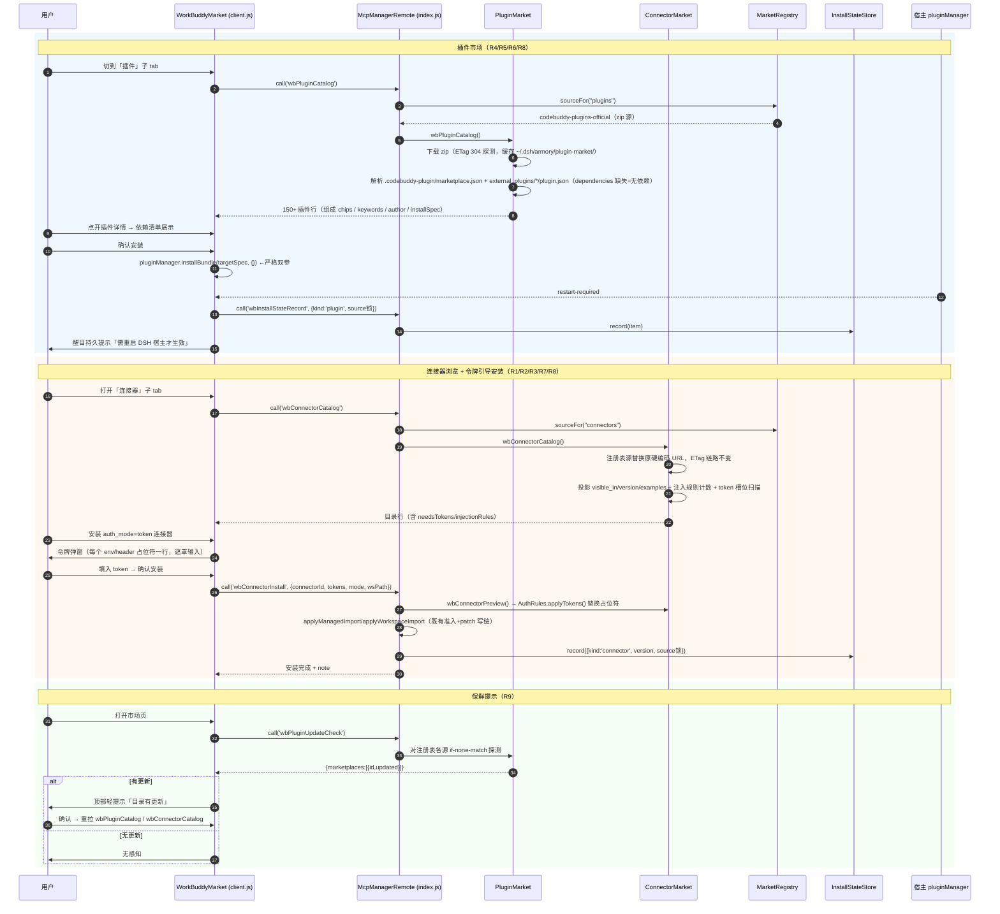
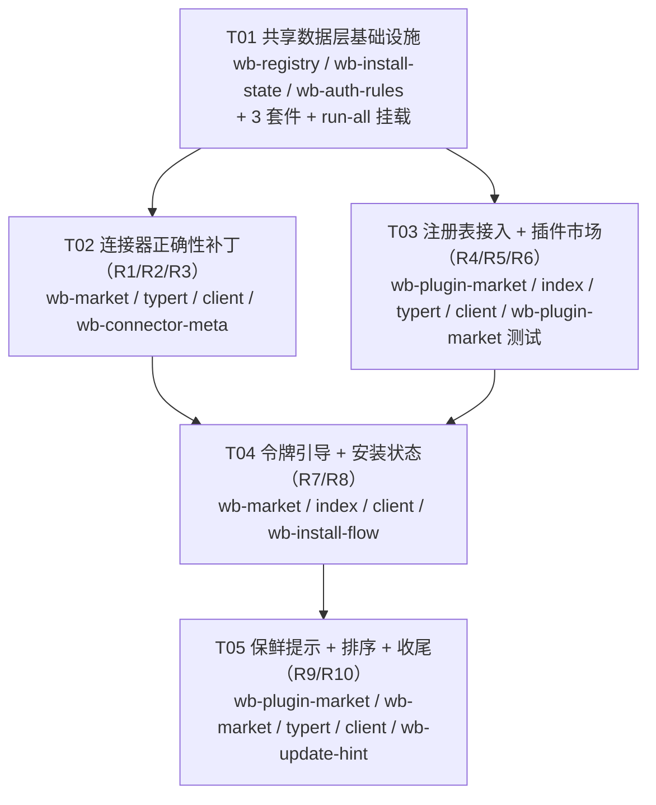

# dsh-armory「WorkBuddy 市场对标」系统设计与任务分解

> 设计：Bob（Architect）｜ 日期：2026-10-20 ｜ 输入：`docs/prd-workbuddy-parity.md`（v1.0，Alice）+ 主理人核实事实包
> 约束基线：纯 JavaScript ESM、零新依赖、Node ≥ 22.15、无构建步骤、Host Remote 契约三件套同步、增量项目（非绿地）。

---

# Part A：系统设计

## 1. 实现方案（Implementation Approach）

### 1.1 核心技术难点与对策

| # | 难点 | 对策 |
|---|------|------|
| D1 | 连接器「残缺安装」：`serverInstallability`（`lib/wb-market.js:118-133`）把 env/header 带 token 的条目一律拒装，80+ 条 auth_mode=token 连接器装不了 | 把「需要 token」从**拒装理由**改造成**可装但需引导**的独立判定：占位符扫描（env/header 值中形如 `${access_token}`、`Bearer ${token}` 的模板槽位）→ 用户自填替换 → 写入 profile。oauth/oneid 类照旧不代注入，但由「静默拒装」升级为「明示不可代注入」（R7 边界） |
| D2 | `auth_injection_rules` 是 WB 账号体系代注入（X9），DSH 不做注入 | 严格收窄为**只解析、只展示**：读顶层 `auth_injection_rules` 数组，按 `applies_to_connectors` 关联到连接器条目，UI 显示「存在 N 条 token 注入规则（依赖 WB 账号体系，DSH 不代注入）」（R1） |
| D3 | 连接器源硬编码单 URL（`lib/wb-market.js:27`），插件源要接进来但不能新增硬编码 | 抽出**多市场注册表** `~/.dsh/armory/marketplaces.json`（借鉴 WB `known_marketplaces.json` schema），连接器 zip 与 codebuddy-plugins-official 都从注册表取源；新增市场 = 新增一条注册表记录，不改代码（R4） |
| D4 | 插件 zip 结构特殊：清单在 `.codebuddy-plugin\marketplace.json`（非根目录），插件条目在 `external_plugins\<name>\.codebuddy-plugin\plugin.json`，条目无 dependencies 字段 | `ZipReader.listByPrefix`（`lib/wb-zip.js:103`）已支持前缀枚举，按实测路径解析；dependencies 做**防御性解析**（字段不存在 = 无依赖，不猜格式；实现时若真实 zip 中出现依赖表达形式再按实测兼容）（R5/R6） |
| D5 | 插件安装走宿主通道，装完不生效要重启 | 客户端直接调 `pluginManager.installBundle(targetSpec, {})`（严格双参，`lib/client.js:3577` 已记录踩坑注释），安装成功后渲染**持久醒目重启提示条**，重启前不消失（R5） |
| D6 | 已安装状态分散（技能=目录即记录、连接器=profile 内 mcpServers、插件=宿主 bundle 列表），无法全量筛选 | 新建统一**本地安装状态 + 来源锁**文件 `~/.dsh/armory/install-state.json`，三类安装写链在各自收尾点同步登记；列表侧以该文件做「已安装」全量筛选（R8） |
| D7 | ETag 缓存已有（`lib/wb-market.js:83` 起，`meta.json` 记 ETag），不能发明平行机制 | R9 复用既有 `loadConnectorZip` 的 304 探测链路，插件市场按同一模式实现（zip 缓存 + meta 记 ETag），只加一个轻量「上游是否有更新」的只读检查方法 |

### 1.2 框架与库选型

- **零新依赖**（PRD 硬约束）。全部能力用既有栈覆盖：
  - ZIP 解压：`lib/wb-zip.js` 的 `ZipReader`（自研 zlib DEFLATE，store/deflate 双支持、大小写不敏感、前缀枚举）——插件 zip 与连接器 zip 同一读取器；
  - 网络下载：`fetch` + UA + 大小上限（沿用 `wb-market.js:52` `fetchWithLimits` 模式）；
  - JSON/原子写盘：`node:fs/promises` + staging-rename 原子替换（沿用 `wbSkillInstall:326-349` 的 staging 模式）；
  - YAML patch：`yaml@2.9.0`（既有 expert-market 写链，本项目不改 patch 写链，连接器安装仍走 `applyManagedImport/applyWorkspaceImport`）；
  - 契约校验：`zod@4.4.3`（typert codec，`$any` 宽容度，沿用 wb* 系列）。
- **架构模式**：沿用 dsh-armory 现有「Host 数据层（lib/*.js 纯函数模块）+ Host Remote 门面（index.js McpManager 方法）+ typert 契约 + client.js 手写 Web 面板」三层结构。本设计不发明平行体系，只做**增量扩展**：新逻辑进新文件，改动落在既有扩展点上。

### 1.3 模块划分（增量）

| 模块 | 性质 | 职责 |
|------|------|------|
| `lib/wb-registry.js` | **新增** | 多市场注册表读写（R4）：内置默认项 + 用户自定义项的合并投影、增删改、ETag/lastUpdated 维护 |
| `lib/wb-install-state.js` | **新增** | 本地安装状态 + 来源锁读写（R8）：`~/.dsh/armory/install-state.json` 的 record/forget/list，原子写 |
| `lib/wb-auth-rules.js` | **新增** | `auth_injection_rules` 解析与关联（R1）+ mcpServers 占位符扫描与 token 替换（R7 的纯函数部分） |
| `lib/wb-plugin-market.js` | **新增** | 插件市场（R5/R6）：按注册表源下载 zip、解析 marketplace.json/plugin.json、目录投影、组成统计、依赖提示、installSpec 计算、ETag 缓存 |
| `lib/wb-market.js` | **修改** | 连接器源改走注册表（R4）；目录投影补 `visible_in/version` 字段（R2/R3）；`serverInstallability` 拆 token 判定（R7 改造点）；`wbConnectorInstall` 支持 tokens + 登记状态 |
| `lib/index.js` | **修改** | 新增 Remote 方法（插件/注册表/状态/更新提示）；`wbConnectorInstall`/`wbSkillInstall` 收尾点登记安装状态 |
| `lib/typert.js` | **修改** | 新增 Remote 方法契约声明（三件套之一） |
| `lib/client.js` | **修改** | 市场面板扩展：插件子 tab、连接器标签/示例/规则提示/令牌弹窗/已安装筛选/排序、重启提示条、更新提示条；契约数组同步（三件套之一） |
| `lib/wb-zip.js` / `lib/expert-market.js` | 不改 | 只复用（ZipReader / recent.json 模式参考） |

## 2. 文件列表（File List）

```
dsh-armory/
├─ lib/
│  ├─ index.js                    # 修改：新增 Remote 方法 + 安装收尾登记状态
│  ├─ typert.js                   # 修改：契约声明三件套之一
│  ├─ client.js                   # 修改：市场面板 UI 扩展 + 契约数组三件套之一
│  ├─ wb-registry.js              # 新增：多市场注册表（R4）
│  ├─ wb-install-state.js         # 新增：安装状态 + 来源锁（R8）
│  ├─ wb-auth-rules.js            # 新增：注入规则解析 + token 占位符（R1/R7）
│  ├─ wb-plugin-market.js         # 新增：插件市场目录/详情/安装规格（R5/R6）
│  ├─ wb-market.js                # 修改：注册表化 + 元数据增强 + 可装性改造（R2/R3/R4/R7）
│  └─ wb-zip.js                   # 不改（复用）
├─ test/
│  ├─ wb-registry.mjs             # 新增：注册表读写/默认项/防御解析
│  ├─ wb-install-state.mjs        # 新增：状态登记/全量筛选投影/原子写
│  ├─ wb-auth-rules.mjs           # 新增：规则关联 + 占位符扫描/替换真值表
│  ├─ wb-plugin-market.mjs        # 新增：构造样例 zip 验证清单解析/依赖提示/组成统计
│  ├─ wb-connector-meta.mjs       # 新增：visible_in/examples/version 投影 + 可装性改造回归
│  ├─ wb-install-flow.mjs         # 新增：令牌替换写链 + 状态登记联动（替身宿主，不联网）
│  ├─ wb-update-hint.mjs          # 新增：ETag 更新提示判定
│  └─ run-all.mjs                 # 修改：挂载上述 7 个新套件
└─ docs/
   ├─ system_design.md            # 本文档
   ├─ sequence-diagram.mermaid    # 时序图抽取
   └─ class-diagram.mermaid       # 类图抽取
```

## 3. 数据结构与接口（Data Structures and Interfaces）

```mermaid
classDiagram
    %% ── 数据模型 ──────────────────────────────────────
    class MarketplaceEntry {
      +string id
      +string kind  %% "connectors" | "plugins"
      +string manifestName
      +string type  %% "zip" | "directory"
      +object source  %% {url, path}
      +string manifestPath
      +boolean autoUpdate
      +boolean isBuiltIn
      +string description
      +number addedAt
      +number lastUpdated
    }
    class InstallStateItem {
      +string kind  %% "connector"|"skill"|"plugin"
      +string key
      +string name
      +string scope
      +string installPath
      +string version
      +string[] dependencies
      +object source  %% {marketplace,url,kind} 来源锁
      +number installedAt
      +number lastUpdated
      +object filesDigest
    }
    class ConnectorRow {
      +string id
      +string name
      +string authMode
      +string version
      +string[] visibleIn
      +string[][] examplesZhEn
      +number tokenSlots
      +number injectionRules
      +boolean installable
      +boolean needsTokens
      +string blockedReason
    }
    class PluginRow {
      +string name
      +string description
      +object author
      +string[] keywords
      +string category
      +object composition  %% {skills,commands,agents,hooks,mcpServers,lspServers}
      +string[] dependencies
      +string installSpec
      +boolean installed
    }

    %% ── Host 数据层 ──────────────────────────────────
    class MarketRegistry {
      -string registryPath()
      +readRegistry()$ Promise~RegistryDoc~
      +upsertMarketplace(entry)$ Promise~RegistryDoc~
      +removeMarketplace(id)$ Promise~RegistryDoc~
      +sourceFor(kind)$ Promise~MarketplaceEntry~
    }
    class InstallStateStore {
      -string statePath()
      +record(item)$ Promise~void~
      +forget(kind, key)$ Promise~void~
      +listInstalled(kind)$ Promise~InstallStateItem[]~
    }
    class AuthRules {
      +parseInjectionRules(indexJson)$ InjectionRule[]
      +rulesFor(rules, connectorId)$ number
      +scanTokenSlots(mcpServers)$ TokenSlot[]
      +applyTokens(mcpServers, tokens)$ object
    }
    class ConnectorMarket {
      +wbConnectorCatalog()$ Promise~CatalogResult~
      +wbConnectorPreview(connectorId)$ Promise~PreviewResult~
      +wbConnectorCachedCount()$ Promise~object~
      -loadConnectorZip() Promise~ZipReader~
      -serverInstallability(name, raw)$ CheckResult
    }
    class PluginMarket {
      +wbPluginCatalog()$ Promise~PluginListResult~
      +wbPluginDetail(payload)$ Promise~PluginRow~
      +wbPluginUpdateCheck()$ Promise~UpdateHint~
      -loadPluginZip(entry) Promise~ZipReader~
    }
    class ZipReader {
      +extract(name) Buffer
      +has(name) boolean
      +listByPrefix(prefix) string[]
    }

    %% ── Host Remote 门面 ─────────────────────────────
    class McpManagerRemote {
      +wbMarketRegistry()$ Promise~RegistryDoc~
      +wbMarketRegistryUpsert(payload)$ Promise~RegistryDoc~
      +wbPluginCatalog(payload)$ Promise~PluginListResult~
      +wbPluginDetail(payload)$ Promise~PluginRow~
      +wbPluginUpdateCheck()$ Promise~UpdateHint~
      +wbInstallState()$ Promise~InstallStateDoc~
      +wbInstallStateRecord(payload)$ Promise~void~
      +wbInstallStateForget(payload)$ Promise~void~
      +wbConnectorInstall(payload)$ Promise~NoteResult~
      +wbSkillInstall(payload)$ Promise~NoteResult~
    }

    %% ── 客户端 ───────────────────────────────────────
    class WorkBuddyMarket {
      -state tab  %% connector|skill|plugin
      -state installedIndex
      -state updateHint
      +render() void
    }
    class ConnectorTab {
      -state visibleInFilter
      -state onlyInstalled
      -state sortKey
      -state tokenModal
      +openTokenModal(slots) void
      +confirmInstall(tokens) Promise~void~
    }
    class PluginTab {
      -state query
      -state restartBanner
      +installPlugin(row) Promise~void~
    }
    class TokenModal {
      +string[] slots
      +confirm() void
      +cancel() void
    }

    McpManagerRemote ..> ConnectorMarket : 转发
    McpManagerRemote ..> PluginMarket : 转发
    McpManagerRemote ..> MarketRegistry : 转发
    McpManagerRemote ..> InstallStateStore : 转发
    ConnectorMarket --> ZipReader : 读取 zip
    PluginMarket --> ZipReader : 读取 zip
    PluginMarket --> MarketRegistry : 取源
    ConnectorMarket --> AuthRules : 规则解析/占位符
    ConnectorMarket --> InstallStateStore : 安装登记（经 index.js）
    PluginMarket --> InstallStateStore : 安装登记（经 index.js）
    WorkBuddyMarket *-- ConnectorTab
    WorkBuddyMarket *-- PluginTab
    ConnectorTab *-- TokenModal
    McpManagerRemote ..> WorkBuddyMarket : call()/installBundle
```

## 4. 程序调用流（Program Call Flow）



## 5. Anything UNCLEAR（不明确项与假设）

1. **插件 installSpec 的最终取值**（假设待实测修正）：WB 插件条目含 repository/homepage 字段，DSH 的 `installBundle(spec, {})` 执行的是 npm spec 安装。设计假设「插件条目的可装 spec = 其 npm 包 spec（优先 repository 推导，其次 registry 记录）；不可推导的条目标注不可装、仅展示」。真实 zip 拿到后以实测为准，若插件本体不是 npm 包形态，则安装通道需降级为「下载 zip 解压到宿主可发现目录」（此时 T03 内修正，不影响整体结构）。
2. **marketplace.json 条目级 dependencies 表达形式**（PRD Open Question 3，事实包第 2 条确认 plugin.json 实测无该字段）：设计按「字段不存在 = 无依赖」防御性解析；R6 的依赖提示实现为「解析到什么就展示什么」，真实依赖样例（如 security-scan 类）解析格式在 T03 实测时补齐。
3. **R9 的「有更新」判定口径**：连接器侧沿用 meta.json 的 ETag（304=无更新、200=有更新）；插件侧按同一模式新增 plugin-market/meta.json。口径 = ETag 与上次落盘不一致。若上游对 HEAD/条件请求返回不稳定，允许降级为「内容哈希比对」但不多做请求。
4. **wbConnectorCachedCount 不受影响**：仍只读磁盘缓存、零网络；插件 chip 计数不在本期范围（PRD 未要求）。
5. **假设**宿主 `installBundle` 对已装同名包会返回 restart-required（与 client.js:3588 注释一致），UI 重启提示条以此为触发；若宿主未来改为热生效，提示条随之自然消失，不需要改设计。

---

# Part B：任务分解

## 6. Required Packages（无新增依赖）

**零新依赖**——本迭代不向 `package.json` 添加任何运行时依赖（PRD 3.1 硬约束）。既有依赖及用途：

```
- yaml@2.9.0: profile patch / 专家市场 YAML 读写（本项目沿用既有写链，不新增调用面）
- smol-toml@^1.8.0: 既有 TOML 解析（本项目不新增使用）
- zod@4.4.3: typert strict codec 的 schema 载体（新 Remote 方法沿用 $any 宽容度，与 wb* 系列一致）
- Node 内置: node:zlib（ZipReader 解 DEFLATE）、node:fs/promises（原子写盘）、fetch（带上限下载）——经 lib/wb-zip.js 与 wb-market.js 既有模式复用
```

## 7. 任务列表（按依赖排序，共 5 个任务）

| 任务 ID | 任务名 | Source Files | Dependencies | Priority |
|---------|--------|--------------|--------------|----------|
| **T01** | **共享数据层基础设施**（本项目「项目基础设施」落地形态：注册表读取器 + 安装状态/来源锁读写器 + 注入规则/占位符纯函数库 + 测试基建扩展） | `lib/wb-registry.js`（新）、`lib/wb-install-state.js`（新）、`lib/wb-auth-rules.js`（新）、`test/wb-registry.mjs`（新）、`test/wb-install-state.mjs`（新）、`test/wb-auth-rules.mjs`（新）、`test/run-all.mjs`（挂载 3 套件） | — | P0 |
| **T02** | **批次一：连接器正确性补丁**（R1 注入规则展示 / R2 visible_in 标签与筛选 / R3 元数据增强；含 R7 改造点预备——可装性判定拆出 needsTokens，但令牌弹窗接线归 T04） | `lib/wb-market.js`、`lib/typert.js`、`lib/client.js`（连接器 tab：标签徽章、版本、示例问法一键复制、规则提示行、visible_in 多选筛选）、`test/wb-connector-meta.mjs`（新） | T01 | P0 |
| **T03** | **批次二：多市场注册表接入 + 插件市场子 tab**（R4 连接器源注册表化 + R5 插件浏览/安装 + R6 依赖提示；安装走 installBundle 双参 + 持久重启提示） | `lib/wb-plugin-market.js`（新）、`lib/index.js`（新 Remote 方法 + 插件链路）、`lib/typert.js`、`lib/client.js`（插件 tab + 重启提示条）、`test/wb-plugin-market.mjs`（新） | T01 | P0 |
| **T04** | **令牌引导安装 + 安装状态落地**（R7 令牌弹窗接线与占位符替换写链 + R8 三类安装登记与「已安装」全量筛选） | `lib/wb-market.js`、`lib/index.js`（wbConnectorInstall/wbSkillInstall 收尾登记）、`lib/client.js`（令牌弹窗 TokenModal + 已安装筛选 + 状态查询接 wbInstallState）、`test/wb-install-flow.mjs`（新） | T01、T02、T03 | P0 |
| **T05** | **批次三：保鲜提示 + 排序 + 集成收尾**（R9 ETag 更新提示条 + R10 连接器排序 + run-all 全量挂载 + 契约一致性终验） | `lib/wb-plugin-market.js`（wbPluginUpdateCheck）、`lib/wb-market.js`、`lib/typert.js`、`lib/client.js`（更新提示条 + 排序下拉）、`test/wb-update-hint.mjs`（新）、`test/run-all.mjs`（挂满 7 套件） | T01、T03、T04 | P1 |

> 任务数 5（硬上限内）；每任务 ≥3 文件；T01/T02/T03 可并行推进（仅 T04 需要 T02 的 UI 骨架与 T03 的注册表就位），避免长线性链。

## 8. Shared Knowledge（跨任务共享知识）

### 8.1 Host Remote 契约三件套同步清单（本次预计新增 8 个方法）

每新增一个 Remote 方法，**三处落点缺一即静默 404**（历史事故：toolTailor、installInfo）：

| Remote 方法 | ① lib/typert.js | ② lib/client.js 契约数组 | ③ lib/index.js McpManager |
|---|---|---|---|
| `wbMarketRegistry` | `TYPERT.invocations` 追加 `mv('wbMarketRegistry', [], 'RegistryResult')` | `REMOTE_CONTRACT` 数组（约 :7464 区域）追加同 id 条目 | `_wbMarketRegistry_decorators = [Remote("wbMarketRegistry")]`（~:931 区域）+ `async wbMarketRegistry()` |
| `wbMarketRegistryUpsert` | `mv('wbMarketRegistryUpsert', [payloadParam], 'RegistryResult')` | 同上区域追加 | decorators + async 方法（参数校验后写注册表） |
| `wbPluginCatalog` | `mv('wbPluginCatalog', [payloadParam], 'WbPluginListResult')` | 同上区域追加 | decorators + async 方法（转发 wb-plugin-market.js） |
| `wbPluginDetail` | `mv('wbPluginDetail', [payloadParam], 'WbPluginDetailResult')` | 同上区域追加 | decorators + async 方法 |
| `wbPluginUpdateCheck` | `mv('wbPluginUpdateCheck', [], 'WbUpdateHintResult')` | 同上区域追加 | decorators + async 方法 |
| `wbInstallState` | `mv('wbInstallState', [], 'InstallStateResult')` | 同上区域追加 | decorators + async 方法 |
| `wbInstallStateRecord` | `mv('wbInstallStateRecord', [payloadParam], 'NoteResult')` | 同上区域追加 | decorators + async 方法（插件安装后客户端回写登记） |
| `wbInstallStateForget` | `mv('wbInstallStateForget', [payloadParam], 'NoteResult')` | 同上区域追加 | decorators + async 方法 |

**改造（非新增）**的既有方法：`wbConnectorInstall`（payload 增加 `tokens`；内部经 `AuthRules.applyTokens` 替换占位符，收尾 `InstallStateStore.record`）、`wbSkillInstall`（收尾 `record`）。三件套签名不变（payload 仍为 `$any`），只改 lib/index.js / lib/wb-market.js 实现。
**守护**：`test/contract-consistency.mjs` 运行时解析三份源码做差集，新增方法漏落点该套件直接红——每个任务收尾必须跑 `node ./test/run-all.mjs`。

### 8.2 测试入口

```
node ./test/run-all.mjs        # 全量（npm test 同义），子进程逐套件、非零即败
node --import ./test/loader.mjs test/<suite>.mjs   # 单套件（loader 重定向 yaml/smol-toml/zod 宿主副本）
```

新增 7 个套件全部挂入 `test/run-all.mjs` 的 `SUITES` 白名单（该文件显式白名单是唯一安全入口，禁止用 `node --test` 自动发现）。新套件纪律：不联网（fetch 替换为必抛函数）、不碰真实 profile、zip 类用构造样例。

### 8.3 `~/.dsh` 新增文件命名约定与 JSON schema 概要

新文件统一收进 `~/.dsh/armory/`（与既有 `~/.dsh/wb-market/` 缓存区并列、互不侵入）：

```jsonc
// ~/.dsh/armory/marketplaces.json —— 多市场注册表（R4）
{
  "version": 1,
  "marketplaces": [{
    "id": "codebuddy-plugins-official",        // 稳定键
    "kind": "plugins",                          // "connectors" | "plugins"（一个 kind 可多条，sourceFor 取第一条）
    "manifestName": "codebuddy-plugins-official",
    "type": "zip",                              // "zip" | "directory"
    "source": { "url": "https://download.codebuddy.cn/plugin-marketplace/codebuddy-plugins-official-4b9366ac-f7e5-4cef-b60a-99a5229ce2b2.zip", "path": "" },
    "manifestPath": ".codebuddy-plugin/marketplace.json",   // 实测：清单在 zip 内该路径，非根目录
    "autoUpdate": false,                        // DSH 永不做静默更新（X4），字段仅记录 WB 语义
    "isBuiltIn": true,
    "description": "CodeBuddy 官方插件市场",
    "addedAt": 0, "lastUpdated": 0
  }]
}
// 内置默认两条（代码内声明，首读时落盘）：connectors → 现有 connectors-config.zip；plugins → codebuddy-plugins-official

// ~/.dsh/armory/install-state.json —— 安装状态 + 来源锁（R8；取 WB upstream-skills-lock.json 之精神）
{
  "version": 1,
  "items": [{
    "kind": "connector",                        // "connector" | "skill" | "plugin"
    "key": "tencent-docs",                      // connector=id；skill=namespace__slug；plugin=插件名
    "name": "腾讯文档",
    "scope": "managed",                         // "managed" | "workspace:<path>"
    "installPath": "",                          // plugin/skill 有值；connector 空串（落 profile）
    "version": "1.0.1",
    "dependencies": [],
    "source": { "marketplace": "workbuddy-connectors", "url": "https://static.workbuddy.cn/...", "kind": "zip" },
    "installedAt": 0, "lastUpdated": 0,
    "filesDigest": { "相对路径": "sha256" }      // 仅 plugin/skill 记关键文件；connector 不记
  }]
}
```

缓存区（非状态、可随时删）：`~/.dsh/armory/plugin-market/plugin.zip` + `meta.json`（`{etag, fetchedAt}`），与 `~/.dsh/wb-market/connectors-config.zip` + `meta.json` 同构。

### 8.4 ETag 缓存复用点

- 连接器：`lib/wb-market.js:83`（`loadConnectorZip` 的 `if (meta.etag)` 304 探测分支）**原样保留**，仅把 `CONNECTOR_ZIP_URL`（:27）的取值改为「注册表 `sourceFor("connectors")` 命中项的 url，缺注册表回落硬编码默认」。
- 插件：`lib/wb-plugin-market.js` 新增同构 `loadPluginZip`（zip 落盘 + meta 记 ETag + 304 探测），复用 `ZipReader`。
- R9：`wbPluginUpdateCheck` 只做条件请求探测、绝不落新包；确认更新 = 重新调 catalog（其内部才会换包）。
- **R9 `wbPluginUpdateCheck` 返回契约（`reason` 枚举值域，Run4b 实测 7 分支后由 Bob 补钉）**：

  | reason | 触发条件 | ok | hasUpdate | 客户端 UI 文案（`lib/client.js` 更新提示按钮态） |
  |---|---|---|---|---|
  | `no-source` | 注册表中无 `kind:"plugins"` 市场源 | false | false | 「未配置插件市场」→ 提示去配置市场源（配置类动作） |
  | `probe-failed` | **有源**但本次探测失败：网络异常/超时，或 HTTP 非 ok（含 5xx/4xx）；探测失败不改变既有缓存 | false | false | 「暂时连不上，稍后重试」→ 仅提示重试，**不得**引导用户重新配置市场（重试类动作） |
  | `no-cache` | 有源 + 本地无缓存（首次使用） | true | true | 触发一次完整 catalog 拉取（视同「有更新」引导刷新） |
  | `up-to-date` | 有源 + 有缓存 + 探测成功（304，或 200 且 ETag 与上次落盘一致） | true | false | 无感知（不渲染提示条） |
  | `update-available` | 有源 + 有缓存 + 探测成功且 ETag 与上次落盘不一致（200 换包） | true | true | 顶部轻提示「目录有更新」+ 确认按钮（确认后重拉 catalog） |

  判定顺序（实现与测试都用同一顺序，避免分支重叠）：`no-source`（先查注册表）→ `probe-failed`（fetch 抛错或 `!response.ok`）→ `no-cache`（本地无 zip/meta）→ `up-to-date` / `update-available`（比对 ETag）。`error` 字段只在 `ok:false` 时携带原始错误文本，供调试展示；**UI 分支只看 `reason`，不看 `error`**。

### 8.5 auth_mode 行为改造点

- `lib/wb-market.js:118-133`（`serverInstallability`）：把 :128-129 的「env/header 带 token → 拒装」改为**拆分输出**——`tokenSlots`（`AuthRules.scanTokenSlots` 扫描的占位符清单）+ `needsTokens` 布尔；其余拒装理由（preAuth、WorkBuddy 专属 command、未知传输）保持从严不动。auth_mode=token 且占位符可替换 → `installable=true, needsTokens=true`，UI 引导填 token；oauth/oneid → `installable=false, blockedReason="不支持代注入，需自备凭据（DSH 不代登录）"`（明示而非静默）。
- `lib/wb-market.js:166`（`authMode` 仅透传）：升级为目录行的一等字段，驱动徽章（`token` 绿 / `oauth` 灰标注）与弹窗分流。
- `auth_injection_rules`：**只解析展示，不注入**（X9）。规则计数经 `AuthRules.rulesFor` 关联到条目，详情面板显示「存在 N 条 token 注入规则（依赖 WB 账号体系，DSH 不代注入）」。

### 8.6 其他跨任务约定

- profile patch 顶层条目永远是补丁指令；若任何链路需要往 patch 新增行，必须 `- insert:` 包装（本项目连接器安装走既有 `applyManagedImport`，不直接改 patch；插件安装走宿主 installBundle，同样不直接改 patch）。
- 插件安装成功后的「需重启 DSH 宿主才生效」提示条：持久渲染于插件 tab 顶部，直至用户重启宿主（组件卸载即消失，重启后 bundle 列表生效），不做 localStorage 持久化（重启即失效，符合语义）。
- 所有列表筛选（已安装 / visible_in 多选 / 排序）均为**全量本地筛选**，不受当前页影响——与技能侧 `skillOnlyInstalled`（仅当前页）的差异要在标签文案写清。
- UI 文案全部走 `t()` 并同步 en-US 字典（`i18n-coverage.mjs` 会抓新增漏键）。

### 8.7 既有回归套件随 R7 演进的迁移规约（Bob 签发，供严过关改测用）

> 背景：R7 已把 `serverInstallability(serverName, rawServer, authMode)`（`lib/wb-market.js:190`）的语义从「鉴权一律拒装」改为「token+可替换槽位 → 放行（`needsTokens=true`），oauth/oneid → 拒装并明示」。`test/auth-gate-regression.mjs` 第 2/3 节 6 条断言基于旧语义，部署新副本后必然变红。本节签发目标形态，**只改测试、不动 lib/**。

#### 8.7.1 断言 2c/2d/2e 的目标形态（鉴权闸门「不得误放」的可判定形式）

采用方案「放行必须伴随可替换槽位」并**加严**：单凭 `needsTokens===true` 不足以证安全（实现上 `needsTokens` 即 `hasReplaceableSlots`，二者恒等价，只断言它是同义反复），必须同时断言**槽位清单非空且每个槽位可判定**（有键名），并把放行集合与拒装集合的**互斥完备性**钉死（auth_mode 非空的 95 条，每条要么进放行集、要么进拒装集，不允许第三态）。可直接照抄的断言文本：

```js
// 2c（替换 :248）：auth_mode 非空的条目，installable===true 的必须同时满足
// needsTokens===true 且 tokenSlots 非空（放行必须伴随可替换槽位，否则即误放）；
// installable===false 的必须 blockedReason 非空。两集合互斥且并集 = 全部 95 条。
const released = authed.filter((row) => row?.installable === true);
const rejected = authed.filter((row) => row?.installable === false);
ok("2c 鉴权条目两态互斥完备：放行 ⇒ needsTokens 且 tokenSlots 非空；拒装 ⇒ blockedReason 非空",
	released.every((row) => row?.needsTokens === true && Array.isArray(row?.tokenSlots) && row.tokenSlots.length > 0)
	&& rejected.every((row) => String(row?.blockedReason || "").length > 0)
	&& released.length + rejected.length === authed.length,
	`放行=${released.length} 拒装=${rejected.length} 共=${authed.length}`);

// 2d（替换 :249）：oauth / oneid-token 条目必须拒装且 blockedReason 指明「不代注入/自备凭据」语义
// （R7 新文案；不再要求 95 条全部拒装——token+槽位型按 R7 放行）。
const oauthRows = authed.filter((row) => /^(oauth|oneid-token|mcp-oauth)$/i.test(String(row?.authMode || "").trim()));
ok("2d oauth/oneid 条目全部拒装且 blockedReason 含「不代注入」",
	oauthRows.every((row) => row?.installable === false && /不代注入|自备凭据|自备凭据/.test(String(row?.blockedReason || ""))),
	`oauth/oneid 条数=${oauthRows.length}`);

// 2e（替换 :250）：判定域收窄到 R7 真正变更的语义域 —— token 型条目不得出现旧文案
// 「DSH 无法自动注入」（防旧写法复活；实测 token 型含旧文案 = 0 条，作为防回归针有意义）。
const tokenRows = authed.filter((row) => /^token$/i.test(String(row?.authMode || "").trim()));
ok("2e token 型条目旧拒装文案「DSH 无法自动注入」不得复活",
	tokenRows.every((row) => !String(row?.blockedReason || "").includes("DSH 无法自动注入")),
	`token 型条数=${tokenRows.length}`);
// 2e 补充（从严区守卫）：server-side / mcp 型条目必须拒装且 blockedReason 非空（不得误放）。
// 从严区措辞不钉死具体字符串（可随文案微调），仅断言非空；旧文案在这两个分支是合法保留项。
const strictRows = authed.filter((row) => /^(server-side|mcp)$/i.test(String(row?.authMode || "").trim()));
ok("2e 从严区（server-side/mcp）条目全部拒装且 blockedReason 非空",
	strictRows.every((row) => row?.installable === false && String(row?.blockedReason || "").length > 0),
	`server-side/mcp 条数=${strictRows.length}`);
```

**修订说明（2e v2）**：v1 对全部 authed 条目断言旧文案不得出现，但 R7 从未要求改 server-side/mcp 分支的措辞（§8.7:421「保持从严不动」），实测 316 条目录、authed=95 中含旧文案的 13 条全部落在 server-side（12）+ mcp（1），token 型为 0 条——v1 按现写法要么必须去改 `lib/wb-market.js:212/:215`（违反 §8.7:434「只改测试、不动 lib/」），要么测试恒红，不可判定。v2 把判定域收窄：正向防回归针只挂在 token 型（R7 真正变更的语义域），从严区改为「拒装 + blockedReason 非空」的守卫式断言。

说明：2c 的互斥完备性比原断言**更强**——旧断言只证「全部拒装」，新断言同时证「放行有据、拒装有因、无第三态」。若 `authed.length===0`（上游目录变更）整节照旧走 SKIP 分支，不受影响。

#### 8.7.2 断言 3b/3c/3d 的目标形态（装链顺序不变式：先替换、再探测、后落盘）

确认你的候选方向正确，按 R7 实际落点（`lib/index.js:1496-1504`）逐字定针。**关键加严**：除四针齐全外，必须断言 `applyTokens` 与 `probeMcpServersAuthorization` 都消费的是 `preview.mcpServers`（而不是中间变量重命名绕针），且探测严格晚于替换、json 组装严格晚于探测——探测早于替换 = 探的是未替换旧凭据（白探），json 早于探测 = 可能把未探测的配置落盘（违背「绝不写一半」）。可直接照抄：

```js
// 3b/3c/3d（替换 :273-282）。四针与 lib/index.js:1496-1504 逐字一致：
const PREVIEW_CALL = "const preview = await wbConnectorPreview(connectorId);";                 // :1496
const APPLY_CALL    = "const { mcpServers, missingSlots } = applyTokens(preview.mcpServers, tokens);"; // :1499
const PROBE_CALL    = "await probeMcpServersAuthorization(mcpServers);";                       // :1503
const JSON_LINE     = "const json = { mcpServers };";                                          // :1504
const atPreview = source.indexOf(PREVIEW_CALL);
const atApply   = source.indexOf(APPLY_CALL);
const atProbe   = source.indexOf(PROBE_CALL);
const atJson    = source.indexOf(JSON_LINE);
ok("3b 源码针齐全：preview / applyTokens / 探测 / json 组装四行均在场",
	atPreview >= 0 && atApply >= 0 && atProbe >= 0 && atJson >= 0,
	`preview@${atPreview} apply@${atApply} probe@${atProbe} json@${atJson}`);
// 3c：替换在 preview 之后，探测在替换之后（探的必须是替换后的 mcpServers——变量名相同即证，
// 因为 PROBE_CALL 消费 mcpServers 而 APPLY_CALL 是唯一对 mcpServers 的解构赋值行）。
ok("3c 装链顺序：preview < applyTokens < 探测",
	atPreview >= 0 && atApply > atPreview && atProbe > atApply,
	`preview@${atPreview} < apply@${atApply} < probe@${atProbe}`);
// 3d：json 组装在探测之后（未探测的配置绝不落盘）。missingSlots 回传行（return {...result, missingSlots}）
// 无需单独钉——它是 3b APPLY_CALL 的解构伴生， APPLY 针在场即证链路存在。
ok("3d 装链顺序：探测 < json 组装（绝不写未探测的配置）",
	atJson >= 0 && atProbe < atJson,
	`probe@${atProbe} < json@${atJson}`);
```

#### 8.7.3 第 0 节哈希预检的去留裁定

**保留哈希预检，采用你给的规程 ①（部署后重钉），但不由严过关改测时顺手改**——重钉是**主理人的部署职责**，不是测试作者职责，两者混在一起会让「哈希对不上」既可能是真漂移也可能是忘了重钉，失去诊断价值。规程如下：

1. **重钉规程（主理人执行）**：每次向 `~/.dsh/profiles/desktop/node_modules/dsh-armory/lib/` 部署新副本后，由主理人计算三文件 SHA-256（`certutil -hashfile <path> SHA256` 或等价），**逐字更新 `EXPECTED_SHA256` 表**并同步 `.r4b-recheck.mjs` 等部署核查脚本；更新动作必须出现在部署记录里（哪个会话、何时、基于哪次 Run），可追溯。
2. **哈希不一致时的处置**：维持现有中止语义（⛔ 不做后续断言）——「测了个并行会话的中间态」的风险仍在，这是这层守卫的原始价值，不能丢。
3. **不采纳方案 ②（改符号一致性断言）的原因**：符号在场证明的是「模块存在」，证明不了「逐字节未被并行会话改写」——中间态检测恰恰需要字节级锚点；且三件套内容随 R7 持续演进，符号清单会变成第二个需要维护的漂移面，成本不降反升。
4. **补充**：哈希预检对象从 `wb-market.js / index.js / client.js` 三件**扩到含新增模块**——`EXPECTED_SHA256` 增补 `wb-auth-rules.js`、`wb-install-state.js`、`wb-plugin-market.js` 三行（由主理人部署时一并重钉），防「新模块被并行会话单独改写」的中间态漏检。

## 9. 任务依赖图（Task Dependency Graph）


